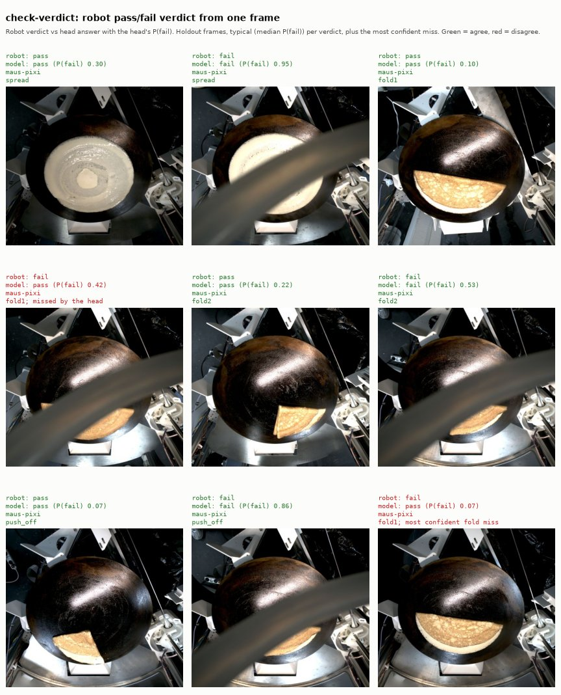

# check-verdict

One small classifier per vision check (`spread`, `fold1`, `fold2`,
`push_off`) that predicts the robot's own pass or fail verdict for a single
camera frame. These are the predictions that Level 1 scores against the
robot.



One typical holdout pass and fail per check (median P(fail)) and the fold
failure the head was most sure was a pass. Rebuild with
`pixi run -e ml model-examples`.

## How it works

1. `frame-embedder` turns the frame into a 576-value embedding.
2. The head for that check is a scaled logistic regression with balanced
   class weights. It reads the embedding and returns `label` (`pass` or
   `fail`) and `probabilities`.

Each check has its own folder: `<check>/model.onnx` and `<check>/model.json`.
The ONNX input is `x` (float32, `[None, 576]`), in the feature order listed in
`model.json`.

## Data and labels

- Rows: every attempt of the check in `training/frames.parquet` that has a
  verdict and an embedding. push_off fails once by design and is then
  retried, so every attempt counts as its own frame.
- Label: `fail` when the robot marked the check not ok. These are weak
  labels. The heads learn to agree with the robot, not to judge crepe
  quality.
- Split: the fixed chronological, run-grouped holdout from `frames.split`.
  Train rows are fit, test rows are only scored.

## Report

Each `model.json` holds:

- the holdout metrics: balanced accuracy, macro F1, agreement with the robot,
  the confusion matrix and calibration
- the same metrics on last attempts only
- two baselines:
  - majority class
  - a logistic regression on the overlay scores in `vision.parquet`,
    for spread, fold1 and fold2 (push_off has none)
- a one-line verdict on whether the head beats the majority baseline

The overlay scores come from the robot's own overlay image. That makes the
overlay baseline close to an upper bound, not a fair competitor.

## Holdout results

Trained on the 1,112 cached frame embeddings, with the holdout made of the
latest 20% of runs that have vision checks. Balanced accuracy (BA) is shown
for both baselines.

| check | test frames | test fails | balanced acc | macro F1 | agreement | majority BA | overlay BA |
|---|---|---|---|---|---|---|---|
| spread | 29 | 13 | 0.91 | 0.90 | 0.90 | 0.50 | 0.74 |
| fold1 | 20 | 7 | 0.68 | 0.69 | 0.75 | 0.50 | 0.66 |
| fold2 | 19 | 5 | 0.76 | 0.78 | 0.84 | 0.50 | 0.82 |
| push_off | 36 | 22 | 0.87 | 0.86 | 0.86 | 0.50 | - |

- All four heads beat the majority baseline.
- spread and push_off are solid: spread catches all 13 test failures, push_off
  18 of 22.
- fold1 and fold2 fall short on failures. fold1 catches 3 of 7 and fold2
  catches 3 of 5. With this few failures in the holdout, their scores are
  rough. fold2 is slightly below the overlay baseline.
- The holdout is small, so a single frame moves balanced accuracy by several
  points. Read these numbers as a first signal, not a final score.

## Train

```
pixi run -e ml python models/check-verdict/train.py [--data-dir ../data]
```

You need `training/frames.parquet` (`pixi run frames`) and
`training/frame_embeddings.parquet` (`pixi run embed`). Training prints the
holdout summary table and each head's verdict.
