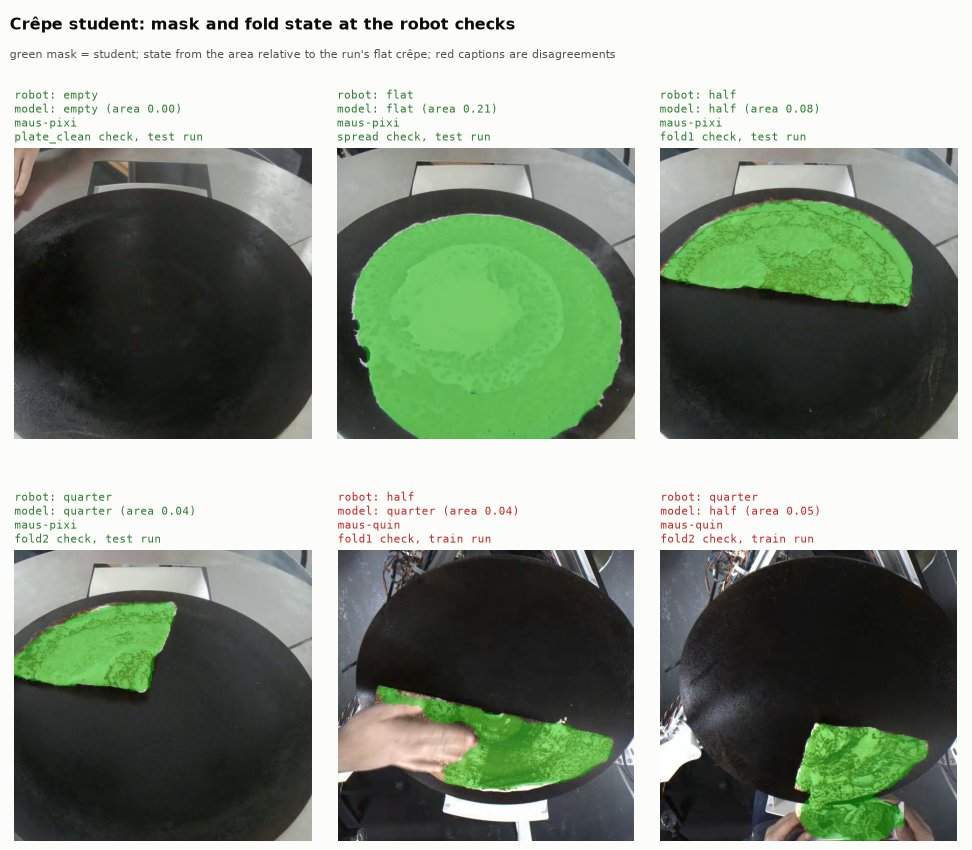

# crepe-student

Crêpe segmentation on the raw hotplate camera frame. A small LR-ASPP
MobileNetV3-Large network distilled from SAM 3 crêpe masks, so the robot
gets a crêpe mask on the CPU without SAM 3 or a GPU.

- `model.onnx` - input `image` float32 `[1, 3, 216, 384]`, output `mask`
  uint8 `[1, 1, 216, 384]` (1 = crêpe)
- `model.json` - model card: preprocessing, state rule, training data,
  metrics, parity and latency
- `train.py` - distils teacher masks into the student and exports it
- `figure.py` - draws `assets/crepe-student-example.jpg`



The two red tiles are the typical failure: a hand over the crêpe at the
check moment changes the area and with it the fold state.

## Use

```python
from maus_export.crepe_student import CrepeStudent, area_share, classify_area

student = CrepeStudent.load()  # needs the ml environment
mask = student.mask(frame_bgr)  # raw camera frame, any size
state = classify_area(area_share(mask), flat_area)
```

For a whole video use `StudentStateMachine` or the CLI:

```bash
pixi run -e ml fold-frames --data-dir /abs/path/to/data
pixi run -e ml fold-student-eval --data-dir /abs/path/to/data
pixi run -e ml fold-student --data-dir /abs/path/to/data --ids 123
```

See [the crêpe student guide](../../../documentation/vision/crepe-student.md)
for the method and the numbers.

## Rebuild

`train.py` needs teacher masks (`teacher.parquet` with `image`, `mask`,
`run_id`). They were made with SAM 3 (`facebook/sam3`, gated on Hugging
Face, CUDA) in the fold prototype, which is not part of the repo
environments yet. With teacher masks in place:

```bash
pixi run -e ml python models/crepe-student/train.py --teacher /abs/teacher.parquet
```

The `ml` environment has a CPU build of PyTorch, so training is slow
(30 epochs took a few minutes on a GPU). The script fails if torch and
onnxruntime disagree on more than 0.1 percent of mask pixels.
