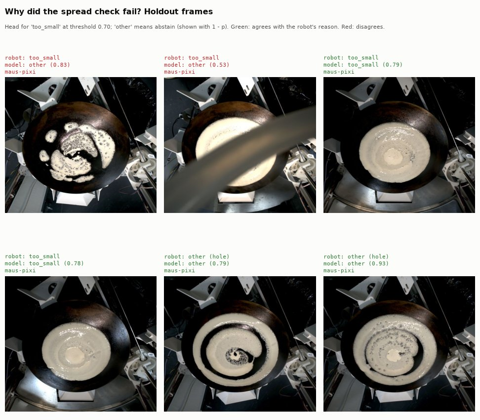

# failure-reason

When a vision check fails, these models predict why, using the robot's own
error strings as labels. **One head is usable, provisionally: "too small"
on the spread check.** Every other reason has too few examples to train or
to score. That outcome is documented per check below.



## Design

- **Rows:** failed frames of the spread, fold1, fold2 and push_off checks
  that have a frame embedding (`models/frame-embedder`). Helpers come from
  `maus_classify.check_verdict` (`check_rows`, `make_head`,
  `embedding_columns`).
- **Labels:** the robot's error strings mapped to reason classes by
  `maus_classify.failure_reason.REASON_CLASSES`. These are weak labels.
  - The two hole messages merge into `hole`.
  - "not a half fold", "not a quarter fold" and "wrong fold shape" merge
    into `shape`.
- **Multi-label, not multi-class.** A failed frame often carries several
  errors: 33 of 91 spread and fold failures have more than one error string,
  and 9 still have more than one reason class after merging. A single
  multi-class label would need an invented "primary" error,
  so each reason class gets its own binary head (scaled L2 logistic
  regression, class-balanced). Each head is trained and exported through
  `maus_classify.harness.train_and_evaluate`, with the onnxruntime parity
  check.
- **Minimum support:** `MIN_SUPPORT = 8` train frames on each side of a head
  (with and without the reason). Classes below it are not modelled; they
  are listed with their support and fall back to `other`.
- **Output:** every modelled class whose probability reaches the check's
  abstain threshold, sorted by confidence. If none does, the answer is
  `other`.
- **Abstain threshold:** chosen per check by run-grouped CV on train frames
  only, as the best mean per-frame set F1 over a grid from 0.50 to 0.95, ties
  to the higher value. The holdout is never used to pick it.
- **Deployable rule (per head):** train CV AUC beats labels shuffled within
  robot (one-sided permutation p < 0.05, 1,000 shuffles), and holdout
  balanced accuracy beats the majority baseline. A head whose holdout has
  one class only cannot be scored and is not deployable.

## Results (local export, 2026-10-31)

The shared holdout is the newest runs, all on maus-pixi. Train covers
maus-quin, maus-otto and maus-pixi.

| Check | Failed frames (train / test) | Modelled | Threshold | Verdict |
|---|---|---|---|---|
| spread | 25 / 13 | `too_small` | 0.70 | `too_small` deployable (provisional) |
| fold1 | 12 / 7 | none | - | not enough data |
| fold2 | 29 / 5 | `residue`, `shape` | 0.55 | research only |
| push_off | 116 / 22 | none | - | not enough data |

### spread: `too_small`

| | Value |
|---|---|
| Support train / test (with, without) | 13 / 12, 5 / 8 |
| Train CV AUC (run-grouped) | 0.90 |
| Shuffled-within-robot null, 5% to 95% | 0.54 to 0.86, p = 0.018 |
| Train CV AUC per robot | maus-pixi 1.00 (9 of 12), maus-otto 0.38 (4 of 6), maus-quin no cases |
| Holdout AUC | 0.80 |
| Holdout balanced accuracy (majority) | 0.64 (0.50) |
| Holdout precision / recall, `too_small` | 0.67 / 0.40 (support 5) |
| Holdout precision / recall, `other` | 0.70 / 0.88 (support 8) |
| Holdout set F1 (majority) | 0.69 (0.38), abstained on 10 of 13 |

Treat this head as provisional:
- **Robot:** "too small" never occurs on maus-quin. The null shuffles within
  robot, so recognising the robot alone does not pass it, but the null is
  already high (up to 0.86).
- **Per robot:** it works on maus-pixi and not on maus-otto (6 frames).
- **Holdout size:** 13 frames, and the head catches 2 of 5 cases at the
  chosen threshold.

Other spread reasons below support: `hole` 7 train / 7 test, `residue` 7 / 2,
`no_crepe` 1 / 1.

### fold2: `residue` and `shape`

- **`residue`:** 9 train cases, none in the holdout. Train CV AUC is 0.74,
  null p = 0.25.
- **`shape`:** 20 train cases. All 5 holdout frames have it, so the holdout
  has one class only. Train CV AUC is 0.62, null p = 0.39.
- Neither beats shuffled labels in train CV, and neither can be scored on the
  holdout. **Research only.**

### fold1 and push_off

- **fold1:** `shape` has 8 train cases but only 4 train frames without it.
  `residue` has 3. No head reaches support 8 on both sides.
- **push_off:** 130 of 138 failed frames (94%) are "crepe not aligned with the
  plate". The majority baseline is therefore right 94% of the time, and the
  other reasons (`no_plate` 5, `no_crepe` 5) are far below support. No head
  is trained; predicting "misaligned" is the baseline to beat.

## Files

- `<check>/model.json`: check card with support per class and split, robots
  covered, modelled classes, abstain threshold and its CV scores, holdout
  set metrics against the majority set, and the verdict.
- `<check>/<class>/model.onnx` and `model.json`: one binary head. Input `x`
  float32 `[N, 576]` (the frame embedding), outputs `label` and
  `probabilities`. The card has train CV per robot, the shuffled-label null
  and the majority baseline.
- `summary.json`: one line per check.
- `train.py`: rebuilds everything and `assets/failure-reason-example.jpg`.

## Rebuild

From `code/`, with `frames.parquet` and `frame_embeddings.parquet` built:

```bash
pixi run -e ml python models/failure-reason/train.py
```

The shared split is due to change to a chronological split within each robot
(#102). Retrain after that lands.
