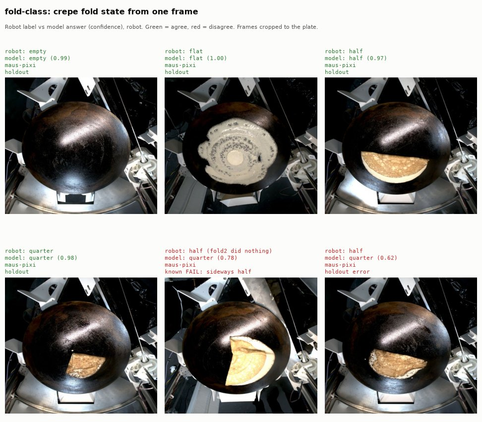

# fold-class

Challenge Task 3 from one frame: is the pan **empty**, or is the crepe
**flat**, folded in **half** or folded in **quarters**, with a probability
for each.

**Scope: it names the fold state of a step that succeeded.** It does not
detect an incomplete fold. Use the check verdict head (#91) to decide
whether a fold succeeded, then this head to say what the crepe looks like.

A logistic-regression head (standardized inputs) on the 576-d output of
the frozen [frame-embedder](../frame-embedder/README.md). Trained, scored and
exported with the shared harness in `maus_classify.harness`.

- `model.onnx` - input `x` float32 `[N, 576]` (embeddings `e0..e575`),
  outputs `label` (string) and `probabilities` float32 `[N, 4]` in the
  order `empty, flat, half, quarter`
- `model.json` - model card: holdout metrics, per-class calibration, the
  confidence check, sanity checks and caveats
- `train.py` - rebuilds both files

## Example



One typical correct holdout frame per class (median confidence, not the
best), the documented FAIL (a sideways half fold read as quarter) and one
holdout error. Rebuild with `pixi run -e ml fold-class-example`.

## Pipeline

```
raw frame -> frame_preprocess.preprocess -> frame-embedder -> fold-class
```

## Labels

These are weak labels:

- a passed spread check is flat
- a passed fold1 is half
- a passed fold2 is quarter (the `fold_class` column of the frame table)
- a passed plate_clean check is an empty pan

Failed checks have no label and are left out. The holdout is the
chronological, run-grouped split fixed in the frame table.

## Results (holdout, latest 20% of runs within each robot)

The holdout mixes all three robots with data (quin, otto, pixi); see the
per-robot split in [documentation/vision/frames.md](../../../documentation/vision/frames.md).

| class | frames | recall |
|---|---|---|
| empty | 34 | 1.00 |
| flat | 22 | 1.00 |
| half | 28 | 0.96 |
| quarter | 26 | 1.00 |

- **Accuracy:** 109 of 110 correct. Balanced accuracy 0.99 (95% run
  bootstrap 0.97 to 1.00).
- **Beats the null:** p = 0.001 against 1,000 refits on train labels
  shuffled within each robot.
- **Per robot (holdout):** otto 1.00, pixi 0.97, quin 1.00.
- **Leave one robot out:** otto 1.00, pixi 0.89, quin 0.73. Every robot beats
  the majority baseline, so the card says it generalizes. A model trained
  without quin drops the most, because quin is most of the data.
- **Calibration:** mean Brier score 0.002.

Training CV per robot (run-grouped, out-of-fold, train rows only):

| robot | frames | accuracy | log loss |
|---|---|---|---|
| quin | 295 | 1.00 | 0.02 |
| pixi | 89 | 0.96 | 0.14 |
| otto | 8 | 1.00 | 0.02 |

The label comes from which check took the frame, so a high score can partly
mean "recognizes the check pose" rather than "reads the fold". The
[leakage check](../../../documentation/training/robustness.md) confirms it
in part: on failed fold2 frames the segmentation calls half, the head says
quarter 84% of the time.

## Sanity checks (frames the head never saw a label for)

| check | expected | n | result |
|---|---|---|---|
| plate_present, passed (holdout) | empty | 23 | 96% empty, pass |
| failed fold1, area unchanged (holdout) | flat | 2 | 100% flat, pass |
| failed fold2, area unchanged (all runs) | half | 3 | 0% half, **fail** |

The two fold rows test label leakage. A fold that failed and changed
nothing leaves the crepe in its previous shape. A head that reads shape
names that shape; a head that learned which check took the frame names the
check's class.

- **Still-flat crepes:** named flat.
- **Still-half crepes after a failed fold2:** never named half. By eye they
  are half folds turned sideways, which no training frame shows. The head
  reads the wedge as quarter, or the pan as empty.
- **Likely cause:** rotation. The head reads the wedge's orientation, not
  the fold, so half vs quarter is only shown to work in the robot's normal
  fold pose.
- **Sample size:** n is small, so this is evidence, not proof.
- **Follow-up:** rotation augmentation (#103), and rotation robustness plus
  the check against human labels on video frames (#104).

On failed fold frames in general, the head spreads its answers over the
classes at 0.77 to 0.92 mean confidence. High confidence does not mean the
fold succeeded.

## Caveats

- **Triangle folds are unsupported.** No frame shows one.
  - The follow-up path is human fold labels from the labelling workstream
    (#87).
  - Its visual taxonomy (crepe-visual-v2) has no triangle label yet, so the
    follow-up (#106) depends on adding one.
- The edge angle for plate alignment is out of scope.

## Rebuild

From `code/`:

```bash
pixi run frames            # data/training/frames.parquet
pixi run -e ml embed       # data/training/frame_embeddings.parquet
pixi run vision            # data/vision.parquet (geometry check)
pixi run -e ml fold-class  # model.onnx + model.json here
```
