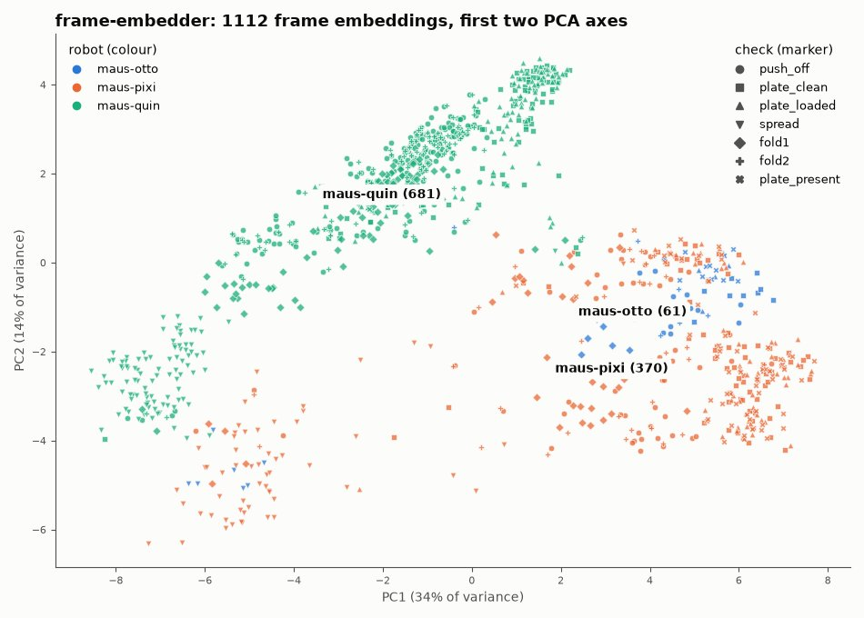

# frame-embedder

Frozen ImageNet MobileNetV3-Small that turns one raw check frame into a
576-d embedding. Small classifier heads train on these embeddings instead of
pixels, so a few hundred frames are enough without overfitting. Nothing here
is trained; fine-tuning and heads are out of scope.

- `model.onnx` - input `x` float32 `[N, 3, 224, 224]`, output `y` float32
  `[N, 576]` (global average pool of the last feature map)
- `model.json` - model card: preprocessing contract, parity check, CPU
  latency and the Raspberry Pi 5 estimate
- `export.py` - rebuilds both files

## Example



The first two PCA axes of every frame embedding, coloured by robot and
marked by check. The robots form separate clusters, so heads trained on
these embeddings can pick up robot identity, not just crepe state. Rebuild
with `pixi run -e ml model-examples`.

## Preprocessing

Always use `maus_export.frame_preprocess.preprocess(bgr)`, for training and
inference alike. It takes the **raw** camera frame (900x509 BGR from
`cv2.imread`, never the overlay), crops the fixed plate box `PLATE_CROP`,
resizes to 224x224, converts to RGB and applies ImageNet normalization.

```python
import onnxruntime as ort
from maus_export.frame_preprocess import load_frame, preprocess

sess = ort.InferenceSession("models/frame-embedder/model.onnx")
emb = sess.run(None, {"x": preprocess(load_frame(path))})[0]  # (1, 576)
```

## Rebuild

From `code/` (downloads the torchvision weights once):

```bash
pixi run -e ml python models/frame-embedder/export.py
pixi run -e ml embed   # cache -> data/training/frame_embeddings.parquet
```

`export.py` fails if torch and onnxruntime differ by more than `1e-4`. See
[frame embeddings](../../../documentation/vision/frame-embeddings.md) for the cache.
