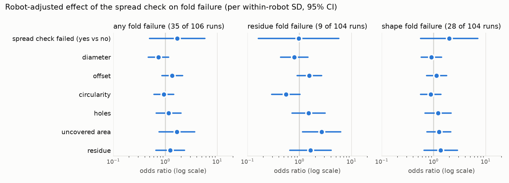

# Fold risk from the spread check

**Pitch takeaway:** in pooled data, a failed spread check looks like a warning
that the fold will fail. Once you compare runs on the same robot, neither the
spread verdict nor any spread score predicts fold failure with today's 106
runs. About 140 runs on the same robots would be enough to detect an odds ratio
of 2 per SD.

This page answers issue #94: can the spread check tell us early that the fold
after it will fail? Figures are aggregates from one private, account-limited
export as of 2026-10-31. A refresh that day found no new runs. The model,
card and code are in [`code/models/fold-risk/`](../../code/models/fold-risk/).

## Data

Why these are 113 of 828 runs, step by step and per robot, is on
[classification data coverage](../training/classification-data.md).

- **Rows:** one per run with a spread check, overlay scores for it in
  `vision.parquet`, and at least one fold check. There are 113 such runs.
- **Features:** these come from the last spread attempt and were fixed before
  the adjusted analysis (pre-registered in #94):
  - the robot's verdict on the spread
  - diameter, offset, circularity, holes, uncovered area and residue
- **Targets:** these are the robot's own fold verdicts, so they are weak
  labels.
  - **any:** a fold1 or fold2 attempt failed
  - **residue:** a fold error "batter left on the plate"
  - **shape:** "not a half fold", "not a quarter fold" or "wrong fold shape"
  - Runs where a fold check saw no crepe are left out of residue and shape.

| Robot | Window (UTC) | Runs | Spread failed | Any fold fail | Residue | Shape |
|---|---|---:|---:|---:|---:|---:|
| maus-quin | Oct 13-20 | 73 | 6 | 15 | 2 | 11 |
| maus-otto | Oct 22 | 7 | 6 | 6 | 5 | 2 |
| maus-pixi | Oct 27-30 | 33 | 9 | 20 | 7 | 17 |

maus-nilo has no runs with vision checks in this export.

## Why robot comes first

Each robot ran in its own time window, so "robot" also stands for era, recipe
and software version. Fold failure differs a lot by robot: 21% on maus-quin,
61% on maus-pixi and 6 of 7 runs on maus-otto. Anything that differs between
robots therefore looks predictive when the robots are pooled.

- Pooled over robots, folds fail after 13 of 21 failed spreads (62%), against
  28 of 92 passed spreads (30%).
- Most failed spreads come from maus-otto and maus-pixi, the robots that fail
  folds anyway. Within one robot the gap mostly disappears. Adjusted for
  robot, the odds ratio for a failed spread is 1.67, with a 95% interval of
  0.50 to 5.53.
- Brightness shows the same trap. Robot explains 25% of the variance in mean
  lightness (pixi images are brighter), and pooled, brighter spreads look
  riskier. Adjusted for robot, the odds ratio per SD is 0.78 [0.50, 1.22].
  Lightness is a robot proxy and is used only as this check.

A single time-ordered holdout cannot fix this, because the latest runs are all
one robot (see [frames](../vision/frames.md)).

## Robot-adjusted effects (primary result)

The fits are Firth-penalized logistic regressions with a robot fixed effect,
one feature at a time, on maus-quin and maus-pixi. Firth with profile
likelihood intervals and likelihood ratio p-values is used because residue has
only 9 events (about 4 per parameter). There, plain Wald intervals are too
narrow and biased away from 1. maus-otto has too few runs to fit and is used
only as an out-of-sample robot below. Continuous features are scaled by their
within-robot SD.

**Holm runs within each mechanism (7 tests), not across all 21.** Correcting
across all 21 would only make the result more conservative.

| Feature | Any (35 of 106) | Residue (9 of 104) | Shape (28 of 104) |
|---|---|---|---|
| Spread failed (yes vs no) | 1.67 [0.50, 5.53] | 1.08 [0.17, 5.20] | 1.96 [0.56, 6.70] |
| Diameter | 0.78 [0.47, 1.10] | 0.79 [0.45, 1.44] | 0.90 [0.58, 1.40] |
| Offset | 1.31 [0.87, 2.13] | 1.44 [0.95, 2.61] | 1.11 [0.75, 1.76] |
| Circularity | 0.95 [0.61, 1.42] | 0.60 [0.30, 0.97] | 0.90 [0.57, 1.35] |
| Holes | 1.04 [0.78, 1.69] | 1.27 [0.94, 2.70] | 1.09 [0.81, 1.83] |
| Uncovered area | 1.37 [0.97, 3.50] | 2.47 [1.12, 5.56] | 1.15 [0.82, 2.14] |
| Residue | 1.08 [0.79, 2.36] | 1.30 [0.94, 4.01] | 1.14 [0.83, 2.81] |

Each cell is the Firth odds ratio per within-robot SD with its 95% profile
interval, before multiple-testing correction. The column headers give fold
failures and runs. The Wald estimates are kept in `model.json` for comparison.

- **No effect survives Holm correction** in any mechanism. The smallest Holm p
  is 0.076.
- The strongest lead is **uncovered area on residue failures**: OR 2.47 per SD
  [1.12, 5.56], p = 0.011, Holm p = 0.076. Under Wald it was 2.66
  [1.15, 6.20]. Firth shrinks it a little but keeps the interval above 1. It
  rests on 9 residue failures, so it is a hypothesis to test with new runs,
  not a finding. The direction is plausible: batter that did not cover the
  plate at spread time is still there at fold time.
- Circularity on residue (OR 0.60 [0.30, 0.97]) is the only other interval
  that excludes 1 before correction.
- **Skewed scores:** holes, residue and uncovered area each have a few runs 8
  to 10 within-robot SDs from the mean. Per-SD odds ratios for these features
  lean on those few runs, which is also why Firth moves them more than the
  others. A transformed scale (log or rank) would be a sensible
  pre-registered choice for a follow-up.

## Power analysis

How big an effect could this data detect, and how many runs would be needed?
This uses the Wald approximation for a logistic slope (Hsieh 1989), with 80%
power, alpha 0.05 Bonferroni-split over 7 features (the strictest Holm step),
and within-robot variance only.

| Mechanism | Runs now | Smallest detectable OR per SD | Runs for OR 2 per SD | Runs for OR 2, spread verdict |
|---|---:|---:|---:|---:|
| Any | 106 | 2.21 | 140 | 1,223 |
| Residue | 104 | 3.64 | 362 | 3,184 |
| Shape | 104 | 2.32 | 154 | 1,354 |

- **Continuous scores:** about 140 to 150 runs on these robots would detect a
  moderate effect (OR 2 per SD) on any or shape failures. Residue failures
  are rare, so that target needs about 360 runs.
- **The robot's spread verdict:** it is rarely "fail" within a robot (6 of 73
  on maus-quin). An OR of 2 would therefore take over 1,200 runs, and only a
  large effect is detectable soon.
- A test in `tests/test_fold_effects.py` checks the formula against
  simulation.

## Model (secondary)

The model is the same seven features, scaled, with L2 logistic regression.
Every check compares against a robot-only baseline (each robot's fold-failure
rate).

The test is a permutation test. Pooled out-of-fold AUC on small, signal-free
data is biased below zero. A bootstrap of fixed out-of-fold predictions also
ignores the variance of refitting, so its interval is too narrow. The test
therefore shuffles labels within each robot and reruns the same CV 1,000 times.

| Check | Result |
|---|---|
| Within-robot delta AUC over robot-only, any (CV 5x5) | -0.13 |
| Same with labels shuffled within robot (1,000 shuffles), 5% to 95% | -0.20 to +0.11 (mean -0.03) |
| One-sided permutation p, any / residue / shape | 0.84 / 0.67 / 0.96 |
| CV inside maus-quin only, AUC [95% CI] | 0.41 [0.27, 0.56] |
| CV inside maus-pixi only, AUC [95% CI] | 0.45 [0.24, 0.65] |
| Leave maus-quin out, AUC [95% CI] | 0.42 [0.27, 0.59] |
| Leave maus-pixi out, AUC [95% CI] | 0.47 [0.27, 0.68] |
| Leave maus-otto out, AUC | 1.00 (only 1 run without a fold failure, not informative) |
| Shared holdout, one robot (maus-pixi, 20 runs), AUC [95% CI] | 0.40 [0.10, 0.75] |

- **No signal, not a reverse signal.** The observed delta AUC sits inside
  the shuffled-label range, and the model does not beat chance inside any
  robot or on an unseen robot. Residue and shape give the same picture.
- The per-robot and leave-one-robot-out intervals bootstrap runs over fixed
  predictions. They show the spread, not a test. `model.json` keeps a
  bootstrap of the pooled delta under the key `resample_ci95`, with that
  caveat attached.
- **Card verdict: research only.** The rule is "deployable" only if
  within-robot delta AUC beats the shuffled-label null (one-sided p < 0.05).
  The ONNX export exists so the analysis can be reproduced and rerun on more
  data, not to run on the robot.

## What would change the answer

- **More runs per robot:** about 150 with spread and fold checks, ideally
  across all four robots and mixed in time, so robot and era stop coinciding.
- **More spread failures inside each robot:** today almost all spread
  failures come from the robots that fail folds anyway.
- **Rerun:** `pixi run -e ml python models/fold-risk/train.py` rebuilds the
  card, the plot and these numbers.
