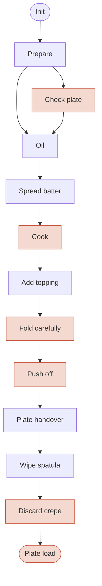
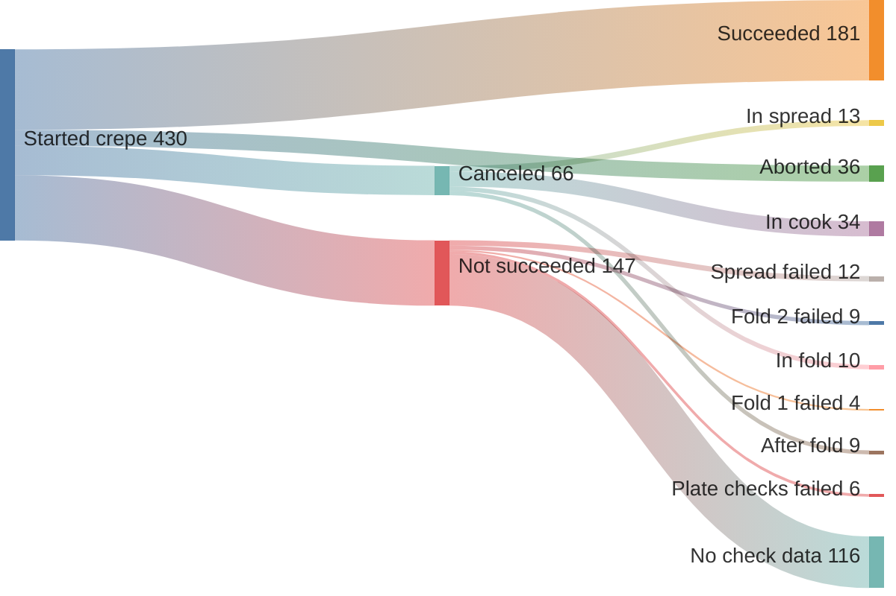

# Crepe stages

The stages (phases) a robot goes through to make one crepe, taken from the
labelled `phases` and `visionChecks` of every run in the Maus dashboard.

Dataset: all 828 runs our account can see (2026-08-30 to 2026-10-31),
from 3 robots. 353 of them are full cycles (they reach both `cook` and
`plate_load`). The other 475 are mostly short test runs that start one
phase on its own (for example `init -> plate_load` 164 times).

## Stage machine

Every run starts at `init` and a full cycle runs these stages in order.
A run can end early, as `canceled` or `aborted`, at any stage. Orange
stages have a vision check.

- `Check plate` only exists in newer runs.
- `Spread batter` is `spread_batter_concentric` (268 runs) or
  `spread_batter` (174 runs).
- `Fold carefully` is **one** phase; both folds happen inside it.
- `Discard crepe` runs in every full cycle, including successful ones. It
  is a clean-up move, not a thrown-away crepe.
- Rare variants: `clear_batter_nozzle` after `prepare` (4 runs),
  `spread_batter_spiral` (1 run), and `cook -> fold_carefully` without a
  topping step (13 runs).

## Stage table

Timings are seconds in each stage over the 353 full cycles. Check fails
are the robot's own verdicts over the 160 runs that have vision checks
(run ids from 3115 on; older runs have none).

| # | Stage | What happens | Median s | p90 s | Check | Fails |
|---|---|---|---|---|---|---|
| 1 | `init` | start the action | 0 | 0 | | |
| 2 | `prepare` | get ready | 6.2 | 9.8 | | |
| 3 | `check_serving_plate` | look for a plate | 1.4 | 62.3 | `plate_present` | 30 / 79 |
| 4 | `oil` | oil the hotplate | 8.7 | 9.1 | | |
| 5 | `spread_batter[_concentric]` | dose and spread batter | 19.7 / 23.5 | 20.0 / 25.2 | | |
| 6 | `cook` | bake | 47.4 | 54.0 | `spread` | 38 / 163 |
| 7 | `add_topping` | pump the topping | 19.1 | 60.9 | | |
| 8 | `fold_carefully` | half fold, then quarter fold | 39.2 | 41.1 | `fold1`, `fold2` | 19 / 138, 34 / 135 |
| 9 | `push_off` | align and push onto the plate | 6.9 | 7.0 | `push_off` | 140 / 259 |
| 10 | `plate_handover` | hand the plate over | 5.2 | 6.0 | | |
| 11 | `wipe_spatula` | clean the spatula | 7.3 | 10.0 | | |
| 12 | `discard_crepe` | clean the hotplate | 21.9 | 23.0 | `plate_clean` | 20 / 182 |
| 13 | `plate_load` | load the next plate | 35.9 | 44.6 | `plate_loaded` | 38 / 172 |

- `add_topping` depends on the topping (median): plain 0 s, raspberry
  17 s, apple 20 s, chocolate 61 s.
- The `push_off` check usually fails once by design: the robot rotates the
  plate and checks again (2 checks per run is most common, up to 8). A
  failed first `push_off` check still ends `succeeded` in 57 runs.

| Check | Failure message |
|---|---|
| `plate_present` | no plate in the slot |
| `spread` | crepe not spread correctly |
| `fold1` | first fold incomplete |
| `fold2` | second fold incomplete |
| `push_off` | not ready for push off |
| `plate_clean` | hotplate not clean |
| `plate_loaded` | plate not loaded |

## Timeline of a full cycle

Median stage durations laid end to end. Median total run time is 213 s;
the crepe reaches the customer after about 147 s.

```mermaid
gantt
    dateFormat ss
    axisFormat %M:%S
    section Make
    Prepare        :a1, 00, 6s
    Oil            :a2, after a1, 9s
    Spread         :a3, after a2, 24s
    Cook           :a4, after a3, 47s
    Add topping    :a5, after a4, 19s
    Fold           :a6, after a5, 39s
    Push off       :a7, after a6, 7s
    section Serve
    Handover       :crit, b1, after a7, 5s
    section Reset
    Wipe spatula   :c1, after b1, 7s
    Discard crepe  :c2, after c1, 22s
    Plate load     :c3, after c2, 36s
```

## Where runs end

The 430 runs that started a crepe (reached a spread or `cook` stage).
The `not_succeeded` split uses the first failed check other than
`push_off`; most of those runs predate vision checks.

Takeaways for the challenge:

- **Spread and folds are the weak points** among runs with check data:
  `spread` (12) and `fold1`/`fold2` (13) explain most `not_succeeded`
  runs.
- **Cancels cluster in `cook`** (34 of 66), the longest stage, so a
  customer-facing wait is the likely cause.
- **`not_succeeded` always ends at `plate_load`**: the robot finishes the
  whole cycle even when the crepe is judged bad, so the failure reason
  must come from the checks and logs, not from where the run stopped.
- Manual labels (`successSpread`, `successFold`, ...) are empty, so the
  robot's own verdicts are the only labels.
