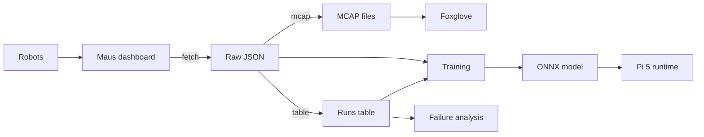
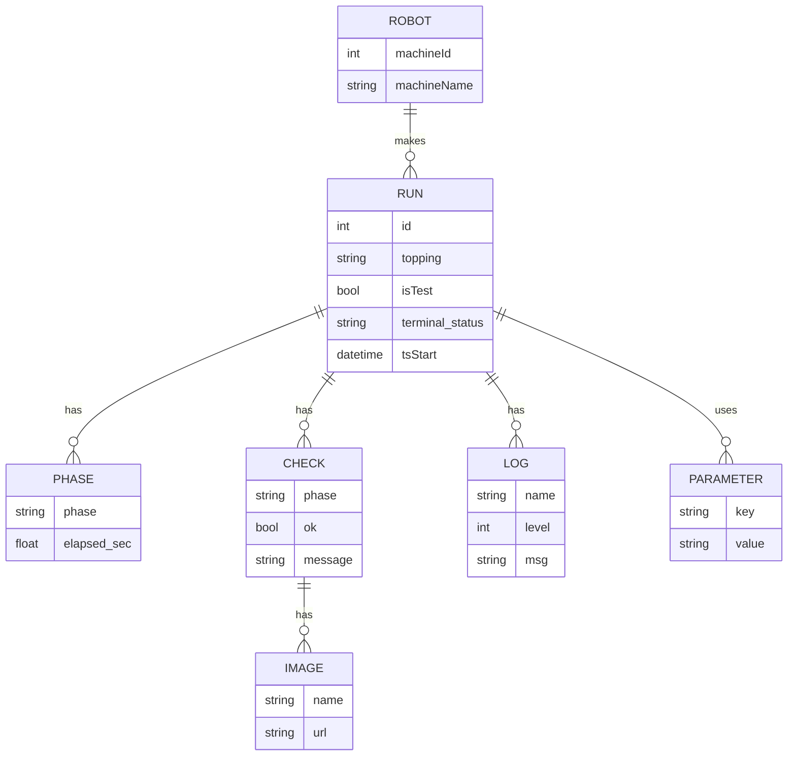

# Data pipeline and data model

## Pipeline

How run data flows from the robots to our analysis. Everything after the
dashboard runs locally; outputs land in the gitignored `data/` folder.
For the preparation history and reproduction checklist, see the
[data preparation handoff](../training/data-preparation-handoff.md).
For private phase-labeling frames, see the
[phase-labeling pilot](../labeling/phase-labeling-pilot.md).

<!-- diagram: pipeline -->

<!-- /diagram -->

| Step | Command / place | Output |
|---|---|---|
| fetch | `pixi run fetch` (MCP over HTTP, OAuth with PKCE) | `data/raw/`: run JSON, check images, videos |
| mcap | `pixi run mcap` | `data/mcap/run_<id>.mcap`, ROS 2 profile, see [mcap.md](mcap.md) |
| table | `pixi run table` | `data/runs.parquet`, one row per run |
| training | `code/models/<name>/train.py` | `model.onnx` plus model card, see [models](../../code/models/README.md) |
| Pi 5 runtime | `onnxruntime` on the robot CPU | target under about 300 ms per frame |
| failure analysis | stage and check statistics | [crepe-stages.md](../system/crepe-stages.md) |

## Run data model

One run as returned by `crepe_get`, and its link to the robot settings
from `robot_list`.

| Entity | Notes |
|---|---|
| RUN | also `machineId`, `orderId` (empty for tests), `tsEnd`, `hotplateTemp`, `envTempStart`, `envHumidityStart`, `videoUrl`, `prevId` / `nextId`; `tsStart` / `tsEnd` are UTC |
| PHASE | also `progress` and `timestamp` |
| CHECK | the vision checks (`visionChecks`), also `errors` and `timestamp` |
| LOG | ROS logger name, Python level 10 to 50 |
| PARAMETER | about 150 recipe and machine settings |
| IMAGE | a `frame` and an `overlay` JPEG per check; the URL needs the bearer token |

`terminal_status` is one of `succeeded`, `not_succeeded`, `canceled`,
`aborted`. Phase, check and log timestamps are naive robot-local time
(Europe/Zurich); see the time zone note in [data.md](data.md).

## Run table columns

`pixi run table` writes `data/runs.parquet` (and a CSV copy), one row per
run, sorted by `id`. Image metric and analysis columns join on `id`.

| Group | Columns | Notes |
|---|---|---|
| Run | `id`, `robot`, `ts_start`, `duration_s`, `topping`, `status`, `last_phase`, `is_full_cycle` | `is_full_cycle` means the run reached `cook` |
| Context | `hotplate_temp`, `env_temp_start`, `env_humidity_start`, `is_test` | |
| Phases | `phase_s.<phase>` | seconds spent in each phase |
| Checks | `check.<name>.ok`, `.error`, `.n` | last attempt; `n` counts attempts (`push_off` retries) |
| Parameters | `param.<key>` | every key that varies across runs; constant keys are dropped, lists are JSON text |
| Config | `config_id`, `segment_id` | export-local hash of varying `param.*`; consecutive runs on one robot with the same config |
| Parameter identity | `parameter_id` | versioned hash of raw per-run parameters; metadata, not a model input |

### Parameter identity and compatibility

`parameter_id` identifies only the raw `parameters` value of each run. It is
computed before building the dataframe, dropping constants, or coercing mixed
column types, and is independent of the other runs and of robot or run metadata.
Identical parameters on different robots therefore share an ID. It does not
identify the robot's other settings, runtime state, or outcome.

Version 1 is `v1:sha256:` followed by the full lowercase SHA-256 hex digest of
UTF-8 encoded Python `json.dumps(parameters, sort_keys=True,
separators=(",", ":"), ensure_ascii=True, allow_nan=False)`. Mapping keys are
sorted recursively; array order is significant. This contract is for JSON
values with string object keys and finite numbers. Non-finite numbers are
rejected. Missing `parameters` and explicit `null` both hash as JSON `null`;
an empty object hashes as `{}` and is distinct. Within an object, a missing
key, a key with `null`, and a key with `{}` are all distinct.

Numbers use the JSON representation produced by Python after parsing: integer
`1` and floating-point `1.0` differ, as do booleans and strings. Numeric lexical
forms lost during JSON parsing, such as `1.0` and `1e0`, are not distinguished.
The version prefix must change if canonicalization changes. A digest is a
fingerprint, not a mathematical guarantee against collisions; it is not a
confidentiality mechanism for sensitive or guessable parameters.

The existing `config_id` and `segment_id` have not changed. `config_id` uses
only parameter columns varying in that export, and `segment_id` numbers
consecutive configurations per robot in that export; neither is a stable
cross-export identifier. Old tables lack `parameter_id` and must be regenerated
from raw runs, since dropped constants and coerced types cannot be recovered
from the table alone. Select actual `param.*` columns for model features; do
not feed `parameter_id` to a model.

## Vision score columns

`pixi run vision` reads the robot's check overlays in
`data/raw/media/<id>/` (download them with `pixi run fetch --media`) and
writes `data/vision.parquet`, one row per run, joined to the run table on
`id`. Each overlay is a rectified top-down view of the plate with the
robot's own analysis drawn in fixed colours; the scores read those
annotations back as numbers. The last attempt of each check is used.

Sizes are relative to the analysis zone (the blue circle, 396.5 px on every
robot), since no millimetre scale is published for the plate.

| Column | Meaning |
|---|---|
| `vision.spread.diameter_rel` | equivalent crepe diameter / zone diameter |
| `vision.spread.area_rel` | crepe area / zone area |
| `vision.spread.offset_rel` | crepe centroid distance from zone centre / zone radius |
| `vision.spread.circularity` | 4 pi area / perimeter^2 of the outline (1 = circle) |
| `vision.spread.hole_frac` | robot-marked hole (red) area / crepe area; the robot marks only some gaps |
| `vision.spread.uncovered_frac` | bare plate (CIE L* < 35, or red) inside the crepe outline / crepe area, bubble specks removed; catches unmarked holes and plate inside a loose outline edge. Shiny glare can be missed |
| `vision.spread.residue_frac` | residue (orange) area / zone area |
| `vision.spread.circle_diameter_rel`, `circle_offset_rel` | robot's fitted circle, same scale |
| `vision.spread.l_mean`, `l_std` | CIE L* of the batter, holes and bare plate excluded |
| `vision.fold1.iou`, `vision.fold2.iou` | overlap of the crepe with the robot's ideal fold shape |
| `vision.fold1.area_rel`, `vision.fold2.area_rel` | folded crepe area / zone area |
| `vision.fold2.area_ratio` | fold-2 area / fold-1 area: about 0.5 for a good quarter fold, about 1 when the second fold did nothing |
| `vision.fold1.l_mean`, `l_std` (and fold2) | browning: CIE L* mean and spread of the crepe |

## Example figure

`pixi run example` redraws `assets/vision-scores-example.jpg`, the annotated
spread and fold-2 example shown in the README, from the overlays in
`data/raw/media/`. Pick other runs with `--spread <id> --fold <id>`, or
write elsewhere with `--out <path>`.
