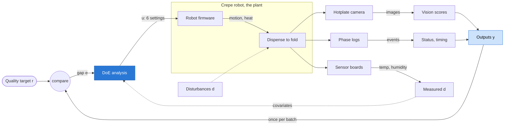
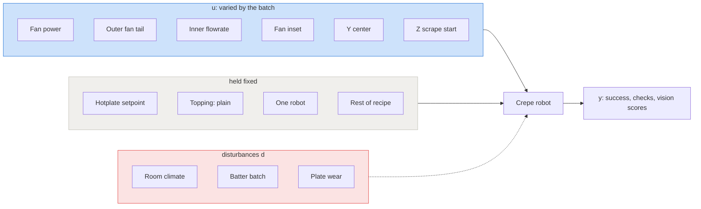
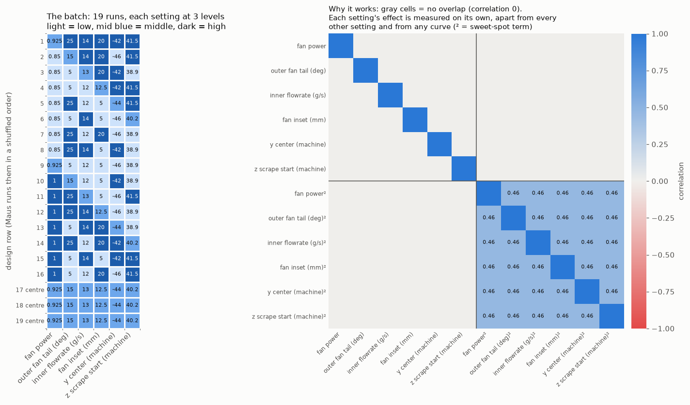

# Designed experiment (DoE batch)

The question: which recipe settings should Maus change, and in which
direction? The run history cannot answer it cleanly (see
[analysis.md](analysis.md)): settings moved together and were tried few times
each. So we hand Maus a small designed batch, 19 runs, that varies six
settings independently. Once those runs are back, the analysis says which knob
to turn, which way, and whether a setting has a sweet spot in the middle.

We never send anything to a robot. The run sheet is a file Maus runs by hand.

Code: `code/maus_export/doe.py` (design), `code/maus_export/doe_analyze.py`
(analysis) and `code/maus_export/doe_figures.py` (figures), all tested offline
in `code/tests/`.

```bash
cd code
pixi run doe --robot <robot>            # writes data/doe/<doe_id>.csv/.parquet
pixi run -e ml doe-analyze data/doe/<doe_id>.parquet   # after the runs
pixi run -e ml doe-figures              # redraws the figures on this page
```

## The control view

Seen from above, the crêpe robot is a plant in a feedback loop. This
experiment works on the **outer loop**: from one batch of crêpes to the next.

<!-- diagram: doe-control-loop -->

<!-- /diagram -->

**Two loops, two timescales.**

- **Inner loops (Maus, real time).** The robot firmware on the Raspberry Pi
  and the Duet boards ([system.md](system.md)) closes fast loops on motion
  and heating, milliseconds to seconds, inside one run. We do not touch them.
- **Outer loop (this work, run to run).** One crêpe is one sample. The
  recipe settings `u` stay fixed during a run. After a run the quality `y` is
  measured and compared with the target `r`, and the settings for the next
  runs are chosen. Today a person closes this loop by hand, by trial and
  error. That is why the history is hard to read.

**What the DoE does in this loop.** It is system identification. The batch
measures how strongly each input moves each output (the gain, our "main
effect") and whether the response bends (curvature). With that map, the next
batch can step `u` towards `r` on purpose. #65 (Bayesian optimization) is the
controller that automates that step.

**Is it a multimodal control system?** On the sensing side, yes. The outputs
come from different kinds of sensors that each see a different part of the
crêpe:

| Modality | Sensor | Becomes |
| --- | --- | --- |
| Images | hotplate camera | vision scores: spread size, coverage, centring, fold shape |
| Event logs | robot software | phase reached, status, timing |
| Environment | sensor boards | room temperature and humidity (measured disturbance) |
| Video | hotplate camera | kept for review, not scored yet |

All of them feed one decision per batch. Actuation is a single modality: the
recipe parameters. So the precise name is a **multi-input multi-output (MIMO)
run-to-run control loop with multimodal feedback**. It is MIMO because 6
inputs drive 9 outputs and the inputs interact. Fan power and fan tail both
shape the spread, for example.

## What varies and what does not

Every signal in the loop, with its role, so it is clear what the batch
changes:



| Role | Symbol | Signals |
| --- | --- | --- |
| Target | `r` | crêpe passes every check: spread big, covered and centred, folds square |
| Varied inputs | `u` | the 6 settings below, 3 levels each |
| Held fixed | | hotplate setpoint, topping (plain), robot, every other recipe setting |
| Measured disturbances | `d` | room temperature and humidity, used as covariates |
| Unmeasured disturbances | `d` | batter batch, plate wear, slow drift. Shuffled run order keeps them from looking like effects |
| Outputs | `y` | success, spread / fold 1 / fold 2 check results, 5 vision scores |

## Controllability

A setting only belongs in `u` if Maus can set it for a run in the robot
software they use today. We checked each candidate against the run history.

**The parameter set changed in October.** From 16 Oct on maus-quin and
27 Oct on maus-pixi (maus-otto always), the robot software uses a new
parameter set. Some settings disappeared, absolute ring radii replaced the
radius offsets, and `concentric_fan_tail_deg` was renamed
`concentric_outer_fan_tail_deg` (same value carried over). The tools read old
runs under the new name (`RENAMED_PARAMETERS` in `to_table.py`). They refuse a
setting that is not in the latest runs.

| Setting | Type | In current software? | Decision |
| --- | --- | --- | --- |
| `dispense.batter.fan_power` | recipe | yes | **vary** |
| `dispense.batter.concentric_outer_fan_tail_deg` | recipe | yes (renamed) | **vary** |
| `dispense.batter.concentric_inner_flowrate_g_s` | recipe | yes | **vary**, small step |
| `dispense.batter.concentric_fan_inset_mm` | recipe | yes | **vary** |
| `machine.y_center` | machine geometry | yes | **vary**, confirm with Maus |
| `machine.z_scrape_start` | machine geometry | yes | **vary**, confirm with Maus |
| `dispense.batter.concentric_inner_fan_power` | recipe | no, gone in the new set | dropped |
| `dispense.batter.concentric_inner_radius_offset_mm` | recipe | no, replaced by `concentric_inner_radius_mm` | dropped |
| `dispense.batter.concentric_outer_radius_offset_mm` | recipe | no, replaced by `concentric_outer_radius_mm` | dropped |

- **Machine geometry.** `y_center` (plate centre position) and
  `z_scrape_start` (height where the scraper starts) are settings, and
  operators did change them on every robot. They describe the machine,
  though, not the recipe. Before running the batch, ask Maus whether they may
  be changed from run to run. If not, drop them from `DEFAULT_FACTORS`; the
  design then uses 4 factors.
- **Ring radii.** The new absolute radii (`concentric_inner_radius_mm`,
  `concentric_outer_radius_mm`) have only ever run at one value each, so
  there is no tested range to vary them in. A later batch can include them if
  Maus picks a range.
- The training dataset uses the same rule: its candidate inputs
  (`training_dataset.py`) are the run-start settings of the current
  software.

## Settings varied

| Setting | Type | Low / middle / high | Level source | Why |
| --- | --- | --- | --- | --- |
| `dispense.batter.fan_power` | recipe | 0.85 / 0.925 / 1.0 | succeeded | raising it helped spread size (#25) |
| `dispense.batter.concentric_outer_fan_tail_deg` | recipe | 5 / 15 / 25 | succeeded | shapes the spread, 8 values tried |
| `dispense.batter.concentric_inner_flowrate_g_s` | recipe | 12 / 13 / 14 | near success | batter amount in the centre, untested away from 13 |
| `dispense.batter.concentric_fan_inset_mm` | recipe | 5 / 12.5 / 20 | succeeded | lowering it helped fold 1 (#25) |
| `machine.y_center` | machine | -46 / -44 / -42 | succeeded | lowering it helped both folds (#25) |
| `machine.z_scrape_start` | machine | 38.9 / 40.2 / 41.5 | succeeded | helped fold 1, mixed evidence (#25) |

Levels as of the current export. `pixi run doe` prints the ones it uses.

**Levels.** The middle level is always the midpoint. Low and high are picked
safest first:

1. **succeeded:** the range where hot full cycles already succeeded (the #25
   shortlist safe range, or the successful runs directly).
2. **near success:** only one value ever succeeded, so the batch tests a
   small step around it (20% of the range ever run). Inner flowrate only ever
   succeeded at 13 g/s; every other value it ran at failed (0 of 9).
3. **ran:** nothing succeeded, so the full range already run. Not used today.

The generator refuses any level outside what the robots already ran. One
risk to know about: outer fan tail 5° succeeded once in 7 runs. The extreme
corners of the batch are where failures are most likely, and a failed run is
still a result.

## Why a Definitive Screening Design

A Definitive Screening Design (DSD, Jones and Nachtsheim 2011) tests each
setting at three levels (low, middle, high) in about two runs per setting.

- **Main effects are independent.** Each setting's direction is estimated
  without being mixed up with any other setting, or with any curvature.
- **Curvature is visible.** The middle level shows if a setting is best
  somewhere inside its range rather than at an edge.
- **Small.** 6 settings take 19 runs: 16 design runs from a conference matrix
  of order 8 (two unused columns make curvature easier to estimate) plus 3
  centre runs that measure plain run-to-run noise.



**How to read it.** Left: the batch, one row per run and one column per
setting, with the value to set (light = low, mid blue = middle, dark = high).
Machine geometry settings are marked. Every setting is low in 7 runs, middle
in 5 and high in 7. The last 3 rows are centre runs with every setting in the
middle. Maus runs the rows in a shuffled order, given in the run sheet.
Right: how much any two terms move together in this batch. The gray cells are
exactly 0, so no setting's effect can be mistaken for another's or for a
curve. Only the curve terms (²) share some overlap with each other (0.46),
which is normal for this design and why curvature is a second, weaker read.

## Run sheet

One row per run, in a random order (seeded, so the same command gives the same
sheet). Random order keeps slow drifts (batter batch, wear) from looking like
setting effects.

| Column | Meaning |
| --- | --- |
| `doe_id` | batch name, `dsd<runs>-<robot>-s<seed>` |
| `run_order` | the order to run in |
| `std_order` | row in the unrandomized design |
| `point_type` | `design` or `centre` |
| `robot`, `topping` | fixed for the batch |
| `<setting>` | value to set |
| `<setting>__coded` | the same value on the -1 / 0 / +1 scale |
| `run_id` | empty: fill in the dashboard run id after each run |

## Analysis

`doe-analyze` reads the sheet, joins each filled `run_id` to `runs.parquet`
and `vision.parquet`, and warns about any run whose setting differs from the
plan. Each outcome from the history analysis (success, check results, vision
scores) gets a least squares fit on the coded settings and their squares. It
prints, per outcome, the settings with p < 0.1 and their direction, and writes
`data/doe/<doe_id>-effects.parquet`.

- A partial batch can be analyzed. With too few runs for curvature it fits
  main effects only.
- Outcomes that never varied in the batch (for example every run succeeded)
  are skipped.
- With 19 runs and 13 terms, p < 0.1 is a screening cut: expect about one false
  alarm per outcome. Confirm a finding with a few follow-up runs.

For every outcome it also draws `data/doe/<doe_id>-<outcome>.png`. This is
what one looks like, on a **simulated** batch (made-up responses, no real
runs yet) where fan power raises the spread size, inner flowrate lowers it,
y center has a sweet spot and the other three do nothing:


**How to read it.** Left: what happens to the outcome when a setting goes
from low to high, with a 90% range. Blue means change it that way helps, red
means it hurts, gray means the batch cannot tell yet. A note marks a sweet
spot, where the best value is inside the range rather than at an edge. Right:
one panel per setting, each run as a dot (with the other settings' effects
taken out), the fitted trend as a line, and the best level as a big dot. In
the example the analysis finds exactly the three planted effects. On the real
batch the panels also show the setting values under low / mid / high.

In control terms the left panel is the gain of each input on this output, and
the right panels are the input-output curves around the operating point.

## Model

`code/models/doe-response/` fits the same model and exports it to ONNX
(inputs: coded settings, outputs: predicted outcomes). That is the plant
model the outer loop needs. `model.onnx` and `model.json` are created once a
real batch is back:

```bash
cd code
pixi run -e ml python models/doe-response/train.py data/doe/<doe_id>.parquet
```

## Next

Sequential Bayesian optimization on top of this batch (suggest the next 4
runs, closing the outer loop automatically) is tracked in #65.
