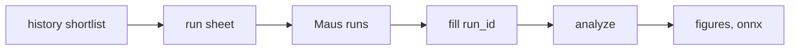

# Designed experiment (DoE batch)

The question: which recipe settings should Maus change, and in which
direction? The run history cannot answer it cleanly (see
[analysis.md](analysis.md)): settings moved together and were tried few times
each. So we hand Maus a small designed batch, about 20 runs, that varies six
settings independently. Once those runs are back, the analysis says which knob
to turn, which way, and whether a setting has a sweet spot in the middle.

We never send anything to a robot. The run sheet is a file Maus runs by hand.



Code: `code/maus_export/doe.py` (design), `code/maus_export/doe_analyze.py`
(analysis) and `code/maus_export/doe_figures.py` (figures), all tested offline
in `code/tests/`.

```bash
cd code
pixi run doe --robot <robot>            # writes data/doe/<doe_id>.csv/.parquet
pixi run -e ml doe-analyze data/doe/<doe_id>.parquet   # after the runs
pixi run -e ml doe-figures              # redraws the figures on this page
```

## Why a Definitive Screening Design

A Definitive Screening Design (DSD, Jones and Nachtsheim 2011) tests each
setting at three levels (low, middle, high) in about two runs per setting.

- **Main effects are independent.** Each setting's direction is estimated
  without being mixed up with any other setting, or with any curvature.
- **Curvature is visible.** The middle level shows if a setting is best
  somewhere inside its range rather than at an edge.
- **Small.** 6 settings take 19 runs: 16 design runs from a conference matrix
  of order 8 (two unused columns make curvature easier to estimate) plus 3
  centre runs that measure plain run-to-run noise.


**How to read it.** Left: the batch, one row per run and one column per
setting, with the value to set (light = low, mid blue = middle, dark = high).
Every setting is low in 7 runs, middle in 5 and high in 7. The last 3 rows
are centre runs with every setting in the middle. Maus runs the rows in a
shuffled order, given in the run sheet. Right: how much any two terms move
together in this batch. The gray cells are exactly 0, so no setting's effect
can be mistaken for another's or for a curve. Only the curve terms (²) share
some overlap with each other (0.46), which is normal for this design and why
curvature is a second, weaker read.

## Settings varied

The six settings come from the history shortlist (`data/analysis/shortlist.json`):

| Setting | Low / middle / high | Why |
| --- | --- | --- |
| `dispense.batter.fan_power` | 0.85 / 0.925 / 1.0 | raising it helped spread size |
| `dispense.batter.concentric_inner_fan_power` | 0.82 / 0.895 / 0.97 | always moved with fan power |
| `machine.y_center` | -46 / -44 / -42 | lowering it helped both folds |
| `machine.z_scrape_start` | 38.9 / 40.2 / 41.5 | helped fold 1, mixed evidence |
| `dispense.batter.concentric_inner_radius_offset_mm` | 2 / 13.5 / 25 | trade-off: success vs spread |
| `dispense.batter.concentric_outer_radius_offset_mm` | -10 / 0 / 10 | always moved with inner offset |

Levels as of the current export; `pixi run doe` prints the ones it uses.

Pairs that always moved together in the history are varied separately here,
so the batch can finally tell them apart.

**Levels.** Low and high are the shortlist's safe range: the values where runs
already succeeded. A setting without a safe range uses the full range already
run. The generator refuses any level outside what the robots already ran, so
the batch never asks for an untested setting. The middle level is the midpoint
of low and high. The command prints the levels it chose.

**Held fixed.** One robot and the plain topping per batch, everything else at
the current recipe, hotplate at its usual setpoint.

## Run sheet

One row per run, in a random order (seeded, so the same command gives the same
sheet). Random order keeps slow drifts (batter batch, wear) from looking like
setting effects.

| Column | Meaning |
| --- | --- |
| `doe_id` | batch name, `dsd<runs>-<robot>-s<seed>` |
| `run_order` | the order to run in |
| `std_order` | row in the unrandomized design |
| `point_type` | `design` or `centre` |
| `robot`, `topping` | fixed for the batch |
| `<setting>` | value to set |
| `<setting>__coded` | the same value on the -1 / 0 / +1 scale |
| `run_id` | empty: fill in the dashboard run id after each run |

## Analysis

`doe-analyze` reads the sheet, joins each filled `run_id` to `runs.parquet`
and `vision.parquet`, and warns about any run whose setting differs from the
plan. Each outcome from the history analysis (success, check results, vision
scores) gets a least squares fit on the coded settings and their squares. It
prints, per outcome, the settings with p < 0.1 and their direction, and writes
`data/doe/<doe_id>-effects.parquet`.

- A partial batch can be analyzed. With too few runs for curvature it fits
  main effects only.
- Outcomes that never varied in the batch (for example every run succeeded)
  are skipped.
- With 19 runs and 13 terms, p < 0.1 is a screening cut: expect about one false
  alarm per outcome. Confirm a finding with a few follow-up runs.

For every outcome it also draws `data/doe/<doe_id>-<outcome>.png`. This is
what one looks like, on a **simulated** batch (made-up responses, no real
runs yet) where fan power raises the spread size, y center lowers it, the
inner radius offset has a sweet spot and the other three do nothing:


**How to read it.** Left: what happens to the outcome when a setting goes
from low to high, with a 90% range. Blue means change it that way helps, red
means it hurts, gray means the batch cannot tell yet. A note marks a sweet
spot, where the best value is inside the range rather than at an edge. Right:
one panel per setting, each run as a dot (with the other settings' effects
taken out), the fitted trend as a line, and the best level as a big dot. In
the example the analysis finds exactly the three planted effects. On the real
batch the panels also show the setting values under low / mid / high.

## Model

`code/models/doe-response/` fits the same model and exports it to ONNX
(inputs: coded settings, outputs: predicted outcomes). `model.onnx` and
`model.json` are created once a real batch is back:

```bash
cd code
pixi run -e ml python models/doe-response/train.py data/doe/<doe_id>.parquet
```

## Next

Sequential Bayesian optimization on top of this batch (suggest the next 4
runs) is tracked in a follow-up issue.
