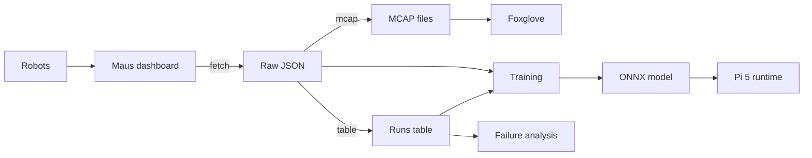
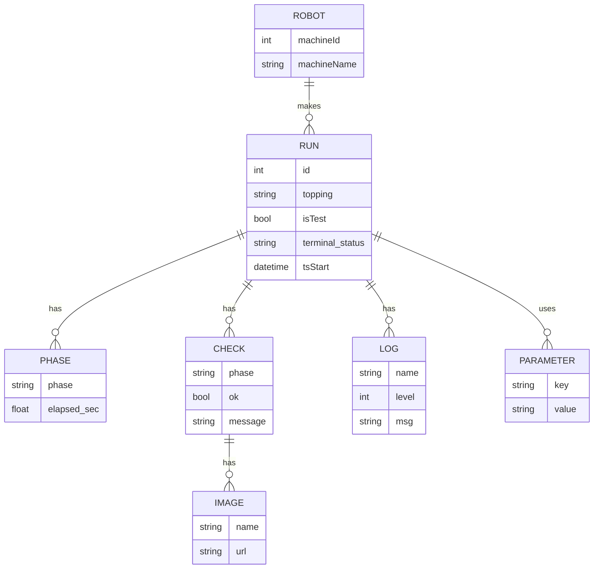

# Data pipeline and data model

## Pipeline

How run data flows from the robots to our analysis. Everything after the
dashboard runs locally; outputs land in the gitignored `data/` folder.

<!-- diagram: pipeline -->

<!-- /diagram -->

| Step | Command / place | Output |
|---|---|---|
| fetch | `pixi run fetch` (MCP over HTTP, OAuth with PKCE) | `data/raw/`: run JSON, check images, videos |
| mcap | `pixi run mcap` | `data/mcap/run_<id>.mcap`, ROS 2 profile, see [mcap.md](mcap.md) |
| table | `pixi run table` | `data/runs.parquet`, one row per run |
| training | `code/models/<name>/train.py` | `model.onnx` plus model card, see [models](../code/models/README.md) |
| Pi 5 runtime | `onnxruntime` on the robot CPU | target under about 300 ms per frame |
| failure analysis | stage and check statistics | [crepe-stages.md](crepe-stages.md) |

## Run data model

One run as returned by `crepe_get`, and its link to the robot settings
from `robot_list`.

| Entity | Notes |
|---|---|
| RUN | also `machineId`, `orderId` (empty for tests), `tsEnd`, `hotplateTemp`, `envTempStart`, `envHumidityStart`, `videoUrl`, `prevId` / `nextId`; `tsStart` / `tsEnd` are UTC |
| PHASE | also `progress` and `timestamp` |
| CHECK | the vision checks (`visionChecks`), also `errors` and `timestamp` |
| LOG | ROS logger name, Python level 10 to 50 |
| PARAMETER | about 150 recipe and machine settings |
| IMAGE | a `frame` and an `overlay` JPEG per check; the URL needs the bearer token |

`terminal_status` is one of `succeeded`, `not_succeeded`, `canceled`,
`aborted`. Phase, check and log timestamps are naive robot-local time
(Europe/Zurich); see the time zone note in [data.md](data.md).

## Run table columns

`pixi run table` writes `data/runs.parquet` (and a CSV copy), one row per
run, sorted by `id`. Image metric and analysis columns join on `id`.

| Group | Columns | Notes |
|---|---|---|
| Run | `id`, `robot`, `ts_start`, `duration_s`, `topping`, `status`, `last_phase`, `is_full_cycle` | `is_full_cycle` means the run reached `cook` |
| Context | `hotplate_temp`, `env_temp_start`, `env_humidity_start`, `is_test` | |
| Phases | `phase_s.<phase>` | seconds spent in each phase |
| Checks | `check.<name>.ok`, `.error`, `.n` | last attempt; `n` counts attempts (`push_off` retries) |
| Parameters | `param.<key>` | every key that varies across runs; constant keys are dropped, lists are JSON text |
| Config | `config_id`, `segment_id` | hash of all `param.*`; consecutive runs on one robot with the same config |
