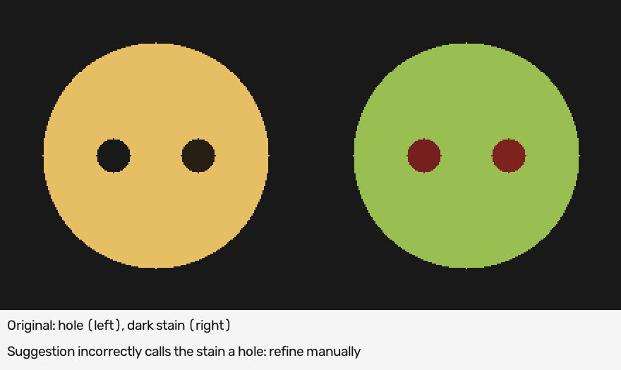

# Simple pixel-mask suggestions

This is plain graphics/image processing: fixed colour thresholds, connected
pixels and small opening/closing filters. There is no GrabCut, clustering,
neural network, pretrained model, colour-model fitting or rectification.

The script makes **suggestions**, not human annotations. It never changes source
images, Label Studio projects, saved labels or the private labels repository.

## Run on one original frame

From the worktree's `code/` directory:

```bash
pixi install --locked
export DATA=/absolute/path/to/maus-crepe-insights/data
pixi run pixel-masks --data-dir "$DATA" \
  --input "$DATA/path/to/original-frame.png" \
  --output "$DATA/pixel-masks/try-1" \
  --roi 360 100 640 620 --min-area 10000
```

`--roi X Y W H` is an optional rectangle in **original image pixels**. Those
example coordinates are not camera calibration and may not fit another image.
Choose a box around the plate/crêpe in the actual image. Outside it is forced
background. Without an ROI, the whole original image is processed.
The 10,000-pixel area in this full-resolution example suppresses small warm
reflections on an empty plate, but can also remove real fragments or early
spreading. It is a deliberate setting, not the general-purpose default.

Each run requires a new output folder, inside `data/` and outside `data/raw/`
and original pilot folders. Existing outputs are never overwritten.

Outputs keep the input width and height:

- `material.png`: suggested material, 0/255.
- `holes.png`: suggested enclosed dark gaps, 0/255, disjoint from material.
- `labels.png`: 0 = other, 1 = material, 2 = hole candidate.
- `preview.png`: green/red suggestions over a copy of the original image.
- `report.json`: input hash, ROI, all fixed parameters and review warnings.

Keep these files private. The preview is for review, not a replacement training
input. No resizing, warping, output-to-label import or automatic acceptance is
performed by the single-image command. To add editable predictions to untouched
set-1 tasks, use the explicit opt-in prefill described below. Saved manual work
is protected rather than replaced.

## What it does

1. Convert a copy of BGR colours to OpenCV Lab and HSV.
2. Select sufficiently light, yellow/warm pixels with bounded saturation.
3. Open tiny specks and close narrow gaps using small pixel neighbourhoods.
4. Keep connected regions above the minimum area. By default keep the largest;
   use `--keep-all` to retain separate large fragments.
5. Find enclosed silhouette gaps. Dark connected regions that do not touch the
   silhouette boundary become hole **candidates**.

This uses colour and proximity only, with no learned weights. Material/hole
semantics still require human review.

## Tune the few thresholds

All colour thresholds use OpenCV byte scales (0-255), not physical units.

| Option | Default | Effect |
| --- | --- | --- |
| `--min-lightness` | 90 | Increase to reject darker plate/noise; may lose browned crêpe |
| `--min-yellow` | 135 | Lab b channel; 128 is neutral, higher values prefer warm/yellow |
| `--max-saturation` | 200 | Lower to exclude strongly saturated distractors |
| `--max-hole-lightness` | 70 | Dark-pixel cutoff for possible bare plate |
| `--opening` | 3 | Odd kernel size; removes small specks and thin connections |
| `--closing` | 5 | Odd kernel size; bridges small gaps |
| `--min-area` | 128 | Minimum material component area in original pixels |
| `--min-hole-area` | 32 | Minimum dark enclosed component area |

Kernel size 1 disables that cleanup step. Keep kernels small: stronger cleanup
can erase thin batter, fill real holes or close an open ragged edge. A blank
result is not proof of an empty plate and must not become a reviewed negative.

## Known limitations

- Dark browning can be indistinguishable from a hole using colour alone.
- Glare/white batter can fail the warm-colour threshold.
- Warm plate residue, hands and tools can be included.
- A tool covering the crêpe may create a false gap or region.
- Largest-region filtering can discard real disconnected crêpe fragments.
- One ROI/threshold setting is not automatically valid for every camera/light.

Inspect previews and refine boundaries and classes before treating any mask as
ground truth. The synthetic example in `assets/pixel-mask-example.png` includes
a deliberately dark stain that becomes a false hole, showing why review matters.



## Prefill untouched mask tasks in either set

Use the recommended [preview-first mask-assistance guide](mask-assist.md) for
set 1 or set 2. It provides a single command family, contact-sheet previews,
tuning, explicit confirmation and exact collaborator/agent instructions.
The lower-level commands below remain available for advanced use.

The opt-in prefill creates editable Label Studio **predictions**, not accepted
annotations. An explicit set number must match the original mask workspace.
Phase tasks,
source images, task data and all human annotations/drafts remain unchanged.
Tasks with any annotation (including skips), draft, lock or existing prediction
are skipped. Protection is checked both before processing and immediately before
each insert. A task opened/edited while masks are being prepared is left alone.

From this feature's worktree, set `SOURCE` to its canonical repository root and
`WORKSPACE` to the existing set-1 workspace. Prepare a new private job:

```bash
pixi run --locked --manifest-path "$SOURCE/code/pyproject.toml" \
  pixel-mask-tasks --set 1 --workspace "$WORKSPACE" --roi 360 100 640 620 \
  --output "$DATA/pixel-masks/set-1-prefill-v1"
```

This example uses an explicit `(360, 100, 640, 620)` ROI and 10,000-pixel
minimum component area. Without an ROI the whole image is processed. These
are not adaptive camera parameters. Check that
they fit the original frames before applying to another camera/dataset.
Empty results are recorded but not imported or declared `no_crepe`.

Inspect the job counts and optionally dry-run the import:

```bash
pixi run --locked --manifest-path "$SOURCE/code/labeling/pixi.toml" \
  prefill-pixels --set 1 --workspace "$WORKSPACE" \
  --suggestions "$DATA/pixel-masks/set-1-prefill-v1"

pixi run --locked --manifest-path "$SOURCE/code/labeling/pixi.toml" \
  prefill-pixels --set 1 --workspace "$WORKSPACE" \
  --suggestions "$DATA/pixel-masks/set-1-prefill-v1" --apply
```

`--apply` makes a consistent local SQLite backup under `app/backups/` before
inserting predictions. Keep it private: it contains account/session data and
must never be pushed to the labels repository. Saved masks are never replaced.
Rerunning a job skips existing predictions rather than duplicating/replacing
them. Locks are protected conservatively, even if a user only opened a task.

The mask project is explicitly marked as allowing only
`pixel-colour-components-v1` predictions and selects that version for display.
Unknown prediction sources remain forbidden, as do all phase-project
predictions. Restart the app using this checkout's `label-set` command or a
merged revision containing this feature. An older launcher will correctly
refuse the new project settings; do not delete annotations or predictions to
bypass that safeguard.

Refresh the mask project. On untouched tasks with nonempty suggestions, edit
the green material/red hole regions using the brush and eraser. No human review
choice is preselected: choose `crepe_present` or `no_crepe` yourself, then
**Submit**. Wrong suggestions can be cleared. The normal mask-export validation
still applies, including disjoint classes and an explicit review state.

Predictions alone are not training targets or completed work. Keep the
prediction source/assistance provenance when reviewing future human exports;
accepted assisted annotations are not the same as independent manual labels.
The prefill does not push any annotations to a repository.
