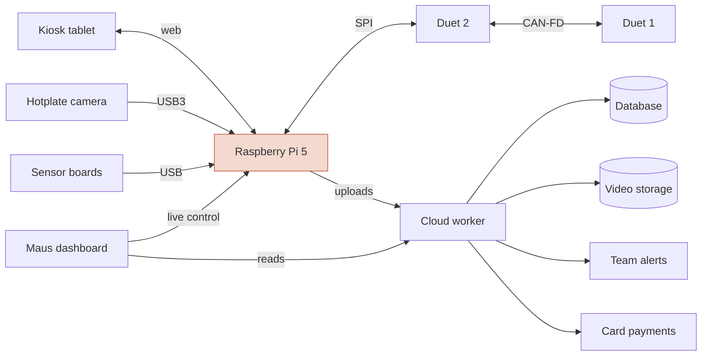
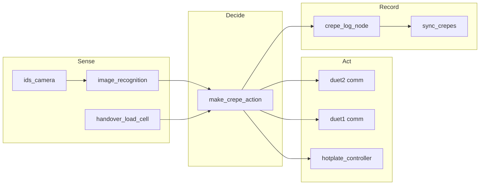
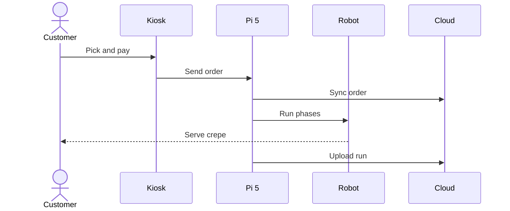

# Robot system

How a Maus crepe robot is built, as described by Maus Robotics in the
BaselHack 2026 challenge material. The source slides are kept locally in
`data/maus-docs/` and are not part of the public repo. Cloud and payment
providers are named by role only.

## Hardware and control architecture

<!-- diagram: system -->

<!-- /diagram -->

| Block | Role |
|---|---|
| Raspberry Pi 5 | the brain: ROS 2 with 15 nodes and 3 cloud uploaders (`sync_crepes`, `sync_orders`, `sync_snapshots`); all decisions are made here |
| Kiosk tablet | customer picks a topping and pays |
| Hotplate camera | industrial camera above the hotplate, used by the vision checks |
| Sensor boards | 2 USB boards: thermal camera and room sensor |
| Duet 2 | main motion board, talks to the Pi over SPI |
| Duet 1 | expansion board, linked to Duet 2 over CAN-FD |
| Cloud worker | "machine-api", holds all keys; receives uploads, alerts and payments |
| Database, Video storage | run records and run videos read by the dashboard |
| Maus dashboard | reads the cloud data and has live control of the Pi through a tunnel |

What this means for our data:

- Run records, logs and vision checks come from `sync_crepes` on the Pi,
  through the cloud worker, into the database the dashboard reads.
- Videos come from the video storage, served as `videoUrl`.
- A vision model has to run on the Pi 5 CPU in under about 300 ms per
  frame (challenge "Level 2").

## Software: ROS 2 nodes

Logger names found in the run logs, grouped by job. The arrows are
inferred from node names and log content.

| Node | Job | Log lines (300 runs) |
|---|---|---|
| `make_crepe_action` | runs the phases, decides on check results | 6.1k |
| `duet2.duet_comm`, `duet1.duet_comm` | send G-code to the motion boards | 5.9k, 5.8k |
| `image_recognition` | runs the vision checks on camera frames | 3.1k |
| `hotplate_controller` | hotplate temperature control | 1.9k |
| `crepe_log_node` | writes the run record | 1.2k |
| `ids_camera` | camera driver | 78 |
| `handover_load_cell` | senses the plate at handover | 18 |
| others | `inventory_node`, `environment_sensor_publish`, `sync_orders`, `web_ui_server`, `foxglove_bridge`, `duet2.duet_temp_logger`, `duet2.duet_cooling`, `duet2.duet_stirrer` | < 300 each |

## Customer flow

From the challenge deck ("Crepes at the push of a button").

The deck promises a crepe in 90 s. Our run data shows a median of 147 s
from the start of a run to the handover. See
[crepe-stages.md](crepe-stages.md) for the phases inside "Run phases".
