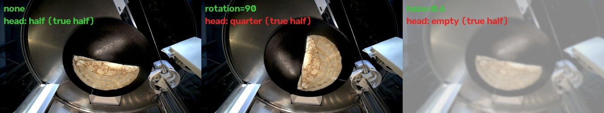

# Classifier robustness

How the frame classifiers hold up when the picture changes: light, steam,
plate rotation and robot. Covers the [fold-class](../../code/models/fold-class/README.md)
head and the four [check-verdict](../../code/models/check-verdict/README.md)
heads, both on top of the frame embedder. Also a label leakage check of the
fold-class head against the classical fold segmentation (#133).

All numbers are aggregates on the `robot-chrono-v2` holdout. Per-frame
outputs stay private under `data/robustness/`.



## Reproduce

From `code/`, with a local export in `data/` (frames, embeddings, models):

```bash
pixi run -e ml robustness          # data/robustness/perturbations.json
pixi run -e ml fold-crosscheck     # data/robustness/fold_crosscheck.json
pixi run -e ml robustness-example  # assets/robustness-example.jpg
```

## Method

Each holdout frame is perturbed, re-embedded and re-scored by every head.

- **Light:** gamma 0.5 to 2.0 and brightness x0.6 to x1.5
- **Steam:** blend toward light grey plus blur (haze 0.2, 0.4, 0.6). A
  stand-in for steam, not real steam
- **Rotation:** the plate disc turns 30, 90 or 180 degrees about its centre.
  The frame is warped to the top-down plate view with the robot's
  calibration, turned and warped back, so the rest of the scene stays put
- **Robot:** every result is also split by robot

Two numbers per setting:

- **Balanced accuracy** against the label (chance: 0.25 fold, 0.50 verdict)
- **Flip rate:** share of answers that change from the unperturbed frame.
  It needs no label

## Results

Fold-class: 110 passed check frames. Verdict: 158 frames, 53 failed checks,
all four heads pooled.

| perturbation | fold BA | fold flips | verdict BA | fail recall | verdict flips |
|---|---|---|---|---|---|
| none | 0.99 | 0.00 | 0.83 | 0.77 | 0.00 |
| gamma 0.5 | 0.99 | 0.00 | 0.76 | 0.68 | 0.09 |
| gamma 0.7 | 0.99 | 0.00 | 0.78 | 0.70 | 0.06 |
| gamma 1.5 | 1.00 | 0.01 | 0.82 | 0.77 | 0.08 |
| gamma 2.0 | 1.00 | 0.01 | 0.79 | 0.79 | 0.17 |
| brightness 0.6 | 1.00 | 0.01 | 0.82 | 0.81 | 0.08 |
| brightness 0.8 | 1.00 | 0.01 | 0.83 | 0.77 | 0.03 |
| brightness 1.25 | 0.99 | 0.00 | 0.83 | 0.72 | 0.06 |
| brightness 1.5 | 0.99 | 0.00 | 0.78 | 0.66 | 0.10 |
| haze 0.2 | 0.99 | 0.00 | 0.77 | 0.66 | 0.07 |
| haze 0.4 | 0.79 | 0.20 | 0.68 | 0.85 | 0.30 |
| haze 0.6 | 0.61 | 0.38 | 0.64 | 0.89 | 0.38 |
| rotation 30 | 0.98 | 0.01 | 0.80 | 0.74 | 0.11 |
| rotation 90 | 0.81 | 0.18 | 0.69 | 0.77 | 0.23 |
| rotation 180 | 0.96 | 0.05 | 0.67 | 0.74 | 0.23 |

- **Light is fine for the fold head.** Under every gamma and brightness
  setting it stays at 0.99 or above and flips at most 1 frame in 100
- **Steam breaks the fold head.** At haze 0.4 a fifth of the answers change.
  At haze 0.6, fold1 frames drop to 0.04 balanced accuracy (0.93 flipped):
  the half fold disappears into the veil and reads as empty or flat.
  plate_clean and spread stay at 1.00
- **Rotation exposes the orientation shortcut.** A 90 degree turn takes
  fold1 to 0.25 (0.71 flipped): a half fold turned sideways reads as
  quarter. A 180 degree turn hurts less (fold1 0.86), because a half moon
  turned upside down still looks like a half moon. fold2, spread and
  plate_clean are unaffected. This backs the finding in the fold-class card
- **Verdict heads are fragile everywhere.** They lose 0.05 to 0.07 balanced
  accuracy under mild light changes and flip 6 to 17% of answers. push_off,
  the strongest head (0.92), falls to 0.54 under 90 and 180 degree rotation:
  it reads where the crepe sits in the pan, not only whether it is there
- **Higher fail recall under heavy haze is not a gain.** The heads call
  more frames failed, so balanced accuracy still drops

### Per robot

| robot | fold n | fold BA none / haze 0.6 / rot 90 | verdict n | verdict BA none / haze 0.6 / rot 90 |
|---|---|---|---|---|
| maus-otto | 6 | 1.00 / 0.50 / 0.88 | 10 | 0.71 / 0.50 / 0.42 |
| maus-pixi | 39 | 0.97 / 0.70 / 0.84 | 58 | 0.78 / 0.58 / 0.66 |
| maus-quin | 65 | 1.00 / 0.56 / 0.79 | 90 | 0.85 / 0.67 / 0.71 |

The pattern is the same on every robot. maus-otto has too few holdout frames
to compare. Robot transfer itself (leave one robot out) is in each model
card.

## Label leakage cross-check

The fold-class labels come from which check took the frame, so the head
could learn check timing instead of the fold. The classical fold
segmentation decides the fold state from the crepe mask and edges, without
knowing the check. Both ran on the same 612 raw check frames.

- **The segmentation is a fair referee here.** On 502 passed checks it
  matches the state the check implies 0.89 of the time (0.885 published on
  video frames). Weakest on half (0.74) and quarter (0.78)
- **On passed checks the two agree:** 0.89 overall, 0.78 on the holdout
- **On failed fold2 checks they split.** 34 frames: the head says quarter
  for 74%, the segmentation says half for 56%. They agree on 38%
- **The leak case:** of 19 failed fold2 frames that the segmentation calls
  half, the head calls 84% quarter. A head reading shape would say half.
  A head reading the check says quarter
- **Failed fold1 (19 frames):** agreement 0.68, with no clear lean

So the fold-class head partly reads the check context. Its 0.99 holdout
score holds for frames taken in the normal pose of each check, and should
not be read as "recognizes the fold shape".

## Limits

- Haze is a synthetic stand-in. Real steam is uneven and moves
- Rotation turns the whole plate disc, rim included. The seam is faint but
  the pan texture turns too
- maus-otto has 6 fold and 10 verdict holdout frames
- The cross-check referee has its own errors (0.74 on half folds), so the
  leakage share is an estimate, not an exact count
- Human labels on video frames are not part of this check

## Follow-up

- Rotation augmentation in training (#103) for the fold-class and push_off
  heads
- Fold labels that do not come from the check (#87) to remove the leak at
  the source
