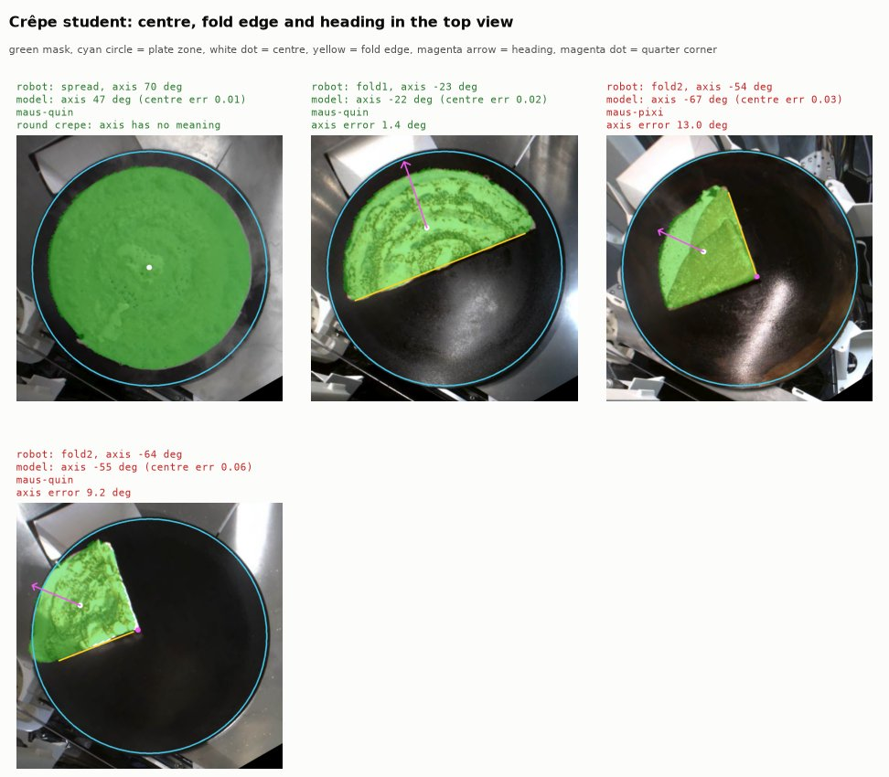

# Crêpe student

A distilled segmentation model that gives the crêpe mask on the raw camera
frame, and a fold state that needs no plate detection. Model files and card:
[`code/models/crepe-student`](../../code/models/crepe-student/README.md).
Code: `maus_export.crepe_student`.

## Why a student

SAM 3 segments the crêpe well from a text prompt ("crepe" or "food") but
needs about a second per frame on a GPU. The student learned SAM 3's masks
on 957 check frames and runs in about 6 ms on four CPU threads. On held-out
runs its masks overlap SAM 3's with a pixel IoU of 0.966.

## Fold state without the plate

Absolute plate shares turned out to differ between robots and camera setups:
the mean robot correction does not fit every run, and a flat crêpe covered
0.48 to 0.83 of the calibrated plate depending on the robot. The area
relative to the flat crêpe of the same run does not have that problem. At the
check moments half a crêpe covers about 0.39 of its flat area and a quarter
about 0.21, on every robot.

`classify_area(area, flat_area)`:

| Condition | State |
|---|---|
| largest mask part below 0.02 of the frame | empty |
| no flat area known yet | flat |
| area / flat area at least 0.60 | flat |
| area / flat area at least 0.30 | half |
| otherwise | quarter |

"No flat area yet means flat" matters for small spreads: the first crêpe on
an empty plate is always a spread, however small. The classical rule read a
too small spread as half, and the state machine then refused to leave empty.

## Live state machine

`StudentStateMachine` runs at 10 analysed frames per second:

- a 9-frame majority vote smooths single frames
- the state only moves forward: empty, flat, half, quarter
- empty must hold 30 frames, so a spatula hiding the crêpe does not reset it;
  then the flat area is forgotten for the next crêpe
- the flat area is the largest area while the crêpe reads as flat
- a fold is only accepted after the flat area has not grown by more than 2
  percent for 50 frames: while batter is poured and spread, the arm hiding
  part of it looks like a fold

`pixi run -e ml fold-student` writes `annotated.mp4`, `timeline.csv`,
`timeline.png` and `summary.json` per run under
`data/fold_segmentation/student/live/`, like `fold-live`.

## Results

`pixi run -e ml fold-student-eval` on the 2026-10-31 export, at the robot
check moments with a passed check (plate_clean = empty, spread = flat,
fold1 = half, fold2 = quarter):

| Group | Frames | Agreement |
|---|---|---|
| all | 991 | 99.5 % |
| test runs of the student | 191 | 99.5 % |
| empty / flat / half / quarter | 298 / 246 / 240 / 207 | 99.7 / 99.6 / 99.2 / 99.5 % |
| maus-quin / maus-pixi / maus-otto | 626 / 353 / 12 | 99.5 / 99.4 / 100 % |
| classical pipeline, same frames | 991 | 88.5 % |

The rule thresholds were read off the same frames, so these numbers are
optimistic. The remaining errors are mostly hands or tools over the crêpe at
the check moment.

Whole videos (live): a run with a too small spread now goes empty, flat,
half, quarter instead of staying empty; a run whose folds failed stays flat
through the fold phase, which is what happened on the plate.

## Position and angle

`maus_export.crepe_pose` turns the student mask into the geometry the spatula
needs. The mask is warped with the robot's image correction into the
corrected top view (the view of the robot's own check overlays) and measured
against the calibrated hotplate circle. Conventions follow
`overlay_pose`: positions in plate (zone) radii from its centre, x right,
y down; angles in image degrees, `atan2(dy, dx)`, so -90 points up.

| Field | Meaning |
|---|---|
| `dx_rel`, `dy_rel` | centre of the crêpe |
| `diameter_rel` | equivalent diameter in plate diameters |
| `axis_deg` | principal axis, +-90 (meaningless for a round crêpe) |
| `edge_deg`, `edge_mid_*`, `edge_len_rel` | the fold line: the longest straight hull edge |
| `heading_deg` | from the fold line (a quarter: its corner) to the centre |
| `corner_*`, `corner_deg` | where a quarter's two edges meet, and their angle |

`fold-student` writes these columns into every live timeline row with a
crêpe. `pixi run -e ml fold-student-pose` scores them at the check frames
against the robot's own overlay measurement (`overlay-pose`, run it first):

| Check | Frames | Centre error, median / p90 | Axis error, median / p90 |
|---|---|---|---|
| fold1 (half) | 131 | 0.023 / 0.034 plate radii | 1.1 / 2.6 deg |
| fold2 (quarter) | 129 | 0.030 / 0.056 plate radii | 1.6 / 7.4 deg |
| spread (flat) | 153 | 0.013 / 0.044 plate radii | no meaning (round) |

The fold line is found on every passed fold1 frame. A quarter corner is
found on 84 % of passed fold2 frames, median 82 deg (10th to 90th
percentile 71 to 88). The corner search only runs when the state is
quarter: a half disc's chord and arc can look like a corner.

Limits: the reference is the robot's own outline, not a human measurement;
positions are in plate radii, no millimetre scale is published; a crêpe
hanging over the plate rim and the robot's mean image correction per robot
both shift the centre a little.

## Against human labels

`pixi run -e ml fold-student-human --labels <folder>` compares the student
with the reviewed Label Studio exports of the labeling project (phase labels
and material/hole brush masks, one frame every 5 s). The labels are private;
point `--labels` at a local folder with `set-*/phase-v1.json` and
`set-*/masks-v1.json`. Frames are decoded from the run videos by
`decoded_frame_index`; the brush RLE decoder gives the same masks as
`label_studio_sdk` on all 121 regions of the current export.

Snapshot 2026-11-01: 5 consecutive runs of one robot, 4 of them student
training runs (other moments of the same crêpes), so read the numbers as
a first check, not a test set.

| Metric | Frames | Result |
|---|---|---|
| mask IoU, student vs human (valid masks) | 62 | median 0.944, mean 0.859 |
| mask IoU, human vs human (same frame, both sets) | 10 | median 0.933 |
| false crêpe on empty plates | 51 | none |
| human hole pixels the student calls crêpe | 29 | median 99.6 % |
| live state vs human phase | 178 | 98.3 % |
| single-frame state vs human phase | 178 | 99.4 % |

On normal frames the student is as close to a human as two humans are to
each other. The mean IoU is lower because of the frames it was never
trained on: small fresh batter at the start of spreading (13 of 30
"spreading" frames read as empty) and a crêpe being pushed off. Live errors
sit at transitions: a fresh half fold still read as flat for a moment, a
quarter already read as empty while it leaves the plate. All hole labels
are in masks that still need review (the hole brush overlaps the material
brush), and the student counts holes as crêpe.

## Limits

- Trained only on check-moment frames: small fresh batter at the start of
  spreading, very small failed spreads, a crêpe being pushed off and hands
  over the plate are outside its training data
- No hole class: holes count as crêpe, so it does not measure spread quality
- No position or angle yet; the mask is in the raw view, not on the plate
- No leave-one-robot-out check; maus-otto has only 6 training runs
- Teacher masks need SAM 3 on a GPU, which no repo environment provides yet
