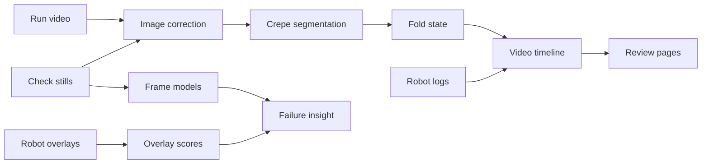

# Vision pipeline

Everything the repo does with the robot's camera, from a raw frame or run
video to an answer on why a run failed. This page is the map: each stage
says what it does, what it writes and where its own page is. All inputs and
outputs are private run data and stay in `data/`.



| stage | question | page |
|---|---|---|
| 1. Inputs | what did the camera see, and when? | [frames](frames.md) |
| 2. Image correction | one top-down view on every robot | [correction](robot-correction.md) |
| 3. Overlay scores | what did the robot measure? | [columns](../data/pipeline.md) |
| 4. Segmentation | where is the crêpe? | [student](crepe-student.md) |
| 5. Fold state | empty, flat, half or quarter? | [segmentation](../fold-segmentation.md) |
| 6. Video timeline | what happened at each check? | [video](../experimental-fold-analysis.md) |
| 7. Frame models | pass, fail and why, per still | [models](../../code/models/README.md) |
| 8. Insight | what leads to a failure? | [fold risk](../analysis/fold-risk.md) |
| 9. Review | see it all next to the video | [run viewer](review-app.md) |

## 1. Inputs

- **Check stills.** Each robot vision check leaves a raw `frame` and an
  annotated `overlay` JPEG under `raw/media/<run id>/`
  (`pixi run fetch --media`).
- **Run video.** `raw/media/<run id>/video.mp4`, the hotplate camera for the
  whole run.
- **Robot logs and phases.** Check names, verdicts and phase timings from
  `raw/runs/<run id>.json`. Log times are naive Europe/Zurich local time;
  `experimental_fold.fold_frames` aligns them to the video clock. See
  [crêpe stages](../system/crepe-stages.md).

`pixi run frames` builds `frames.parquet`: one row per check attempt, the
robot's verdict as a weak label, and the fixed run-grouped split every model
uses ([frame dataset](frames.md),
[data coverage](../training/classification-data.md)).

## 2. Image correction

The cameras differ between robots, so the same crêpe sits at a different
place and scale. Two experiments map frames into one top-down view:

- [Camera rectification](rectification.md) fits a projective map from a raw
  still to the robot's own rectified overlay, and applies it to raw pixels
  only.
- [Per-robot correction](robot-correction.md) averages the accepted maps
  into one correction per robot (`pixi run estimate-correction`,
  `pixi run apply-correction`, `pixi run review-correction`). The result is
  `robot-image-calibration.json` at the repo root, which the video analysis
  loads.

Neither is physical camera calibration. Angles stay in image coordinates.

## 3. Overlay scores

The robot draws its own analysis onto each overlay in fixed colours. Two
readers turn that paint back into numbers, without any model:

- `pixi run vision` writes `vision.parquet`: spread size, offset,
  circularity, holes, residue, fold IoU, fold area ratio and browning.
- `pixi run overlay-pose` writes `overlay_pose.parquet`: crêpe position and
  angle per check attempt, the reference labels for Task 2.

Both column lists are on [pipeline and data model](../data/pipeline.md).

## 4. Crêpe segmentation

Two ways to find the crêpe in a frame:

- **Classical** (`maus_export.fold_*` and `maus_export.experimental_fold`):
  find the plate ellipse, threshold inside it, compare with an empty-plate
  reference, reject glare and specular highlights, and abstain when a narrow
  bright object (arm, spatula) reaches into the plate. On video, causal
  majority masks over recent frames smooth single-frame noise. See
  [fold segmentation](../fold-segmentation.md) and
  [experimental fold analysis](../experimental-fold-analysis.md).
- **Crêpe student** (`code/models/crepe-student`): a small ONNX segmenter
  distilled from SAM 3 masks, on the raw frame. It runs in about 6 ms on
  four CPU threads and overlaps SAM 3 with a pixel IoU of 0.966 on held-out
  runs. See [crêpe student](crepe-student.md).

The video analysis can use either one (`--model classical`, `onnx` or
`both`); the student's mask is then mapped into the corrected view with the
same camera correction. Human masks from the
[labeling](../labeling/mask-labeling.md) work are the reference for the
student (`pixi run -e ml fold-student-human`).

## 5. Fold state

Three independent answers to "empty, flat, half or quarter?":

| method | input | how |
|---|---|---|
| classical rule | corrected mask | plate and flat shares, shape, tie-break |
| student rule | student mask | area relative to the run's flat crêpe |
| `fold-class` head | raw still | logistic head on the frame embedding |

At passed check moments the student rule agrees with the expected state on
99.5% of 991 frames and the classical pipeline on 88.5%. Both rules were
tuned on the same export, so these numbers are optimistic. The `fold-class`
head scores 109 of 110 on its holdout;
`pixi run -e ml fold-crosscheck` checks it against the classical method for
label leakage ([robustness](../training/robustness.md)).

## 6. Video timeline

`pixi run fold-experimental-live`, `pixi run fold-watch` and the Pi
`detect` command analyse a whole run video at 10 frames per second (a
200 ms budget per frame):

- segment and classify every sampled frame, with occlusion abstention
- vote the visual state for one second after each logged check start and
  compare it with the state the check expects, giving success, failure or
  unknown with vote support
- supervise dough dispensing from plate coverage (first, peak and settled
  final share), flagging a dough that collapses after spreading
- mark the logged phases and inferred stages (initial cleaning, toppings)
  for display only

Each run gets `annotated.mp4`, `timeline.csv`, `timeline.png` and
`summary.json` under `fold_segmentation/live/<run id>/` (classical) or
`fold_segmentation/live-onnx/<run id>/` (student masks).
`pixi run -e ml fold-student` is a separate live state machine built on the
student rule, with the same outputs under
`fold_segmentation/student/live/`.

## 7. Frame models

Small heads on one shared, frozen embedding of the raw still:

```
raw still -> frame_preprocess -> frame-embedder (576-d) -> heads
```

| model | answers | card |
|---|---|---|
| frame-embedder | the shared 576-d embedding | [card](../../code/models/frame-embedder/README.md) |
| check-verdict | would the robot pass this check? | [card](../../code/models/check-verdict/README.md) |
| fold-class | which fold state (Task 3)? | [card](../../code/models/fold-class/README.md) |
| failure-reason | why did a check fail? | [card](../../code/models/failure-reason/README.md) |

Every model is ONNX run with onnxruntime, with a card next to it
([models](../../code/models/README.md)). Embeddings are cached for training
with `pixi run -e ml embed` ([frame embeddings](frame-embeddings.md)).
Of the verdict heads only push_off is strong; of the reason heads only
"too small" on the spread check is usable.

## 8. From vision to insight

Vision outputs become run-level answers in `maus_classify` and the analysis
pages:

- [Fold risk](../analysis/fold-risk.md): does the spread frame predict a
  later fold failure? Within a robot it does not, in the current data
- [Vision targets](../training/vision-targets.md): overlay scores joined to
  the run-start settings, for the
  [settings analysis](../analysis/analysis.md) and the
  [designed experiment](../analysis/doe.md)
- [Classifier robustness](../training/robustness.md): the heads under light,
  steam, rotation and unseen robots
- [Deviation and fine-tuning](../training/deviation-pipeline.md): where
  human masks and model masks disagree, as the next training set

## 9. Review

- **Fold review site** (`pixi run fold-watch`, or `detect` on the
  [Raspberry Pi](../system/raspberry-pi.md)): the annotated video beside
  the phase chart, the check list with visual verdicts and the dough
  verdict per run. Its **Segmentation** selector switches between the
  classical and the ONNX student analysis of the same run.
- **Run viewer** (`maus-export view`): one video with the pipeline layers
  for the frame under the playhead, where new producers plug in
  ([run viewer](review-app.md)).
- **Live overlay** (`maus-export overlay`): every layer drawn onto a video
  or stream ([live overlay](live-overlay.md)).

## Limits

- **Most labels are the robot's own verdicts.** A model that agrees with
  the robot has learned the robot, not the truth. Where the two disagree,
  either one can be wrong.
- **Tuned and scored on the same export.** The classical thresholds and the
  student rule were read off the frames they are scored on.
- **Image correction is an average per robot**, not calibration. Camera
  movement or a bad mean map breaks plate estimates and angles.
- **Occlusion.** Arms, spatulas and hands cause most errors in every method.
  The classical gate abstains on narrow objects only, and student masks do
  not use it.
- **Still frames versus video.** The frame heads were trained on check
  stills; running them on video frames is not validated.
- **Speed on the Pi.** Classical video analysis took a median 413 ms per
  frame on a Raspberry Pi 3, so the 200 ms target is not met.
- **Nothing here controls the robot.** All of it is offline analysis.
