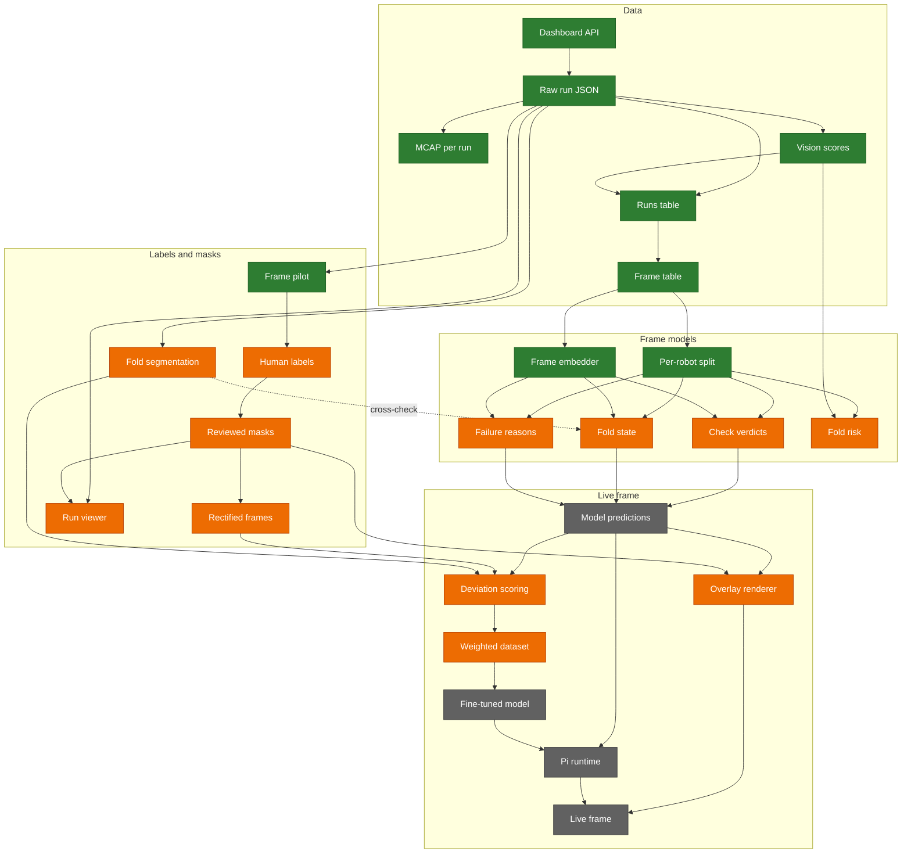
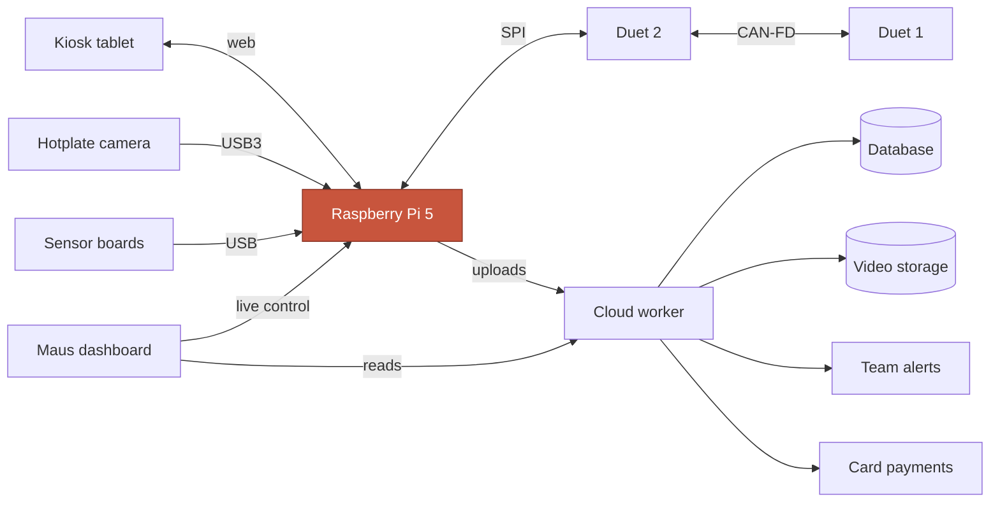
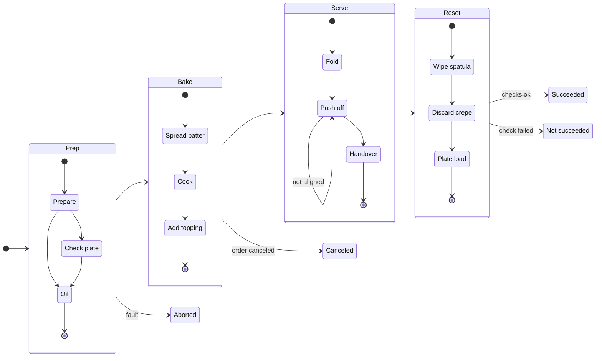
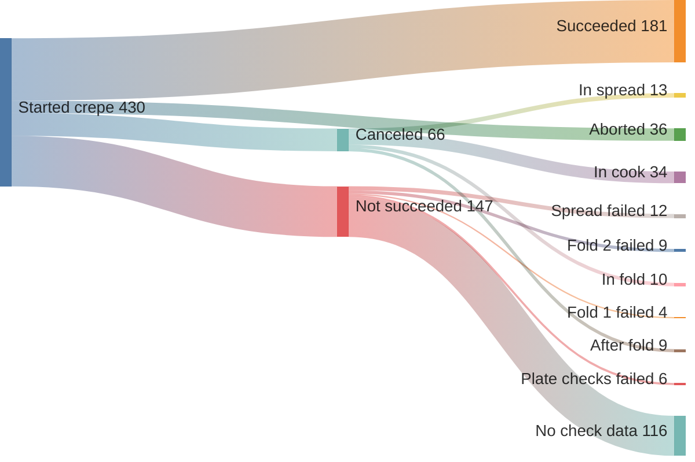
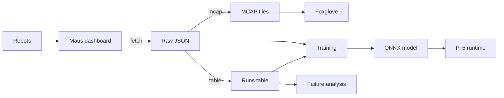
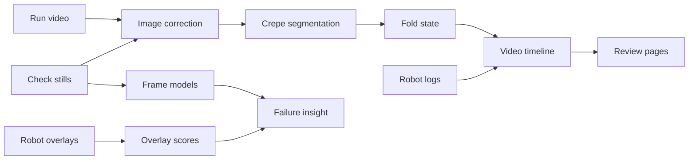
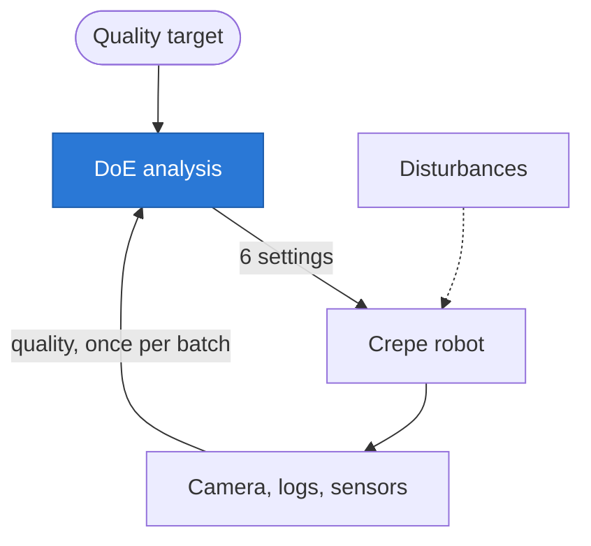

# Maus Crêpe Insights - BaselHack 2026

Our BaselHack 2026 project on the **Maus Robotics** challenge. Maus builds autonomous crêpe robots.
Every run is logged with phases, machine logs, on-robot vision checks (with images), recipe parameters and video.
We turn that data into insight: why runs fail, which settings and conditions matter, and how to catch problems early.

**What is in the repository today.** 828 runs exported from the
dashboard as raw JSON and as one ROS 2 MCAP per run, a 177-column runs
table covering every run and its outcome, a per-check verdict model and
a fold-state model shipped as ONNX with model cards, and a private
labeling setup with phase, mask and pixel-prefill workflows. The exact
state, including what does not work yet, is in
[documentation/status.md](documentation/status.md).

**Check it yourself in a minute.**

```bash
cd code && pixi install && pixi run test && pixi run lint
```

The suite runs offline, with no dashboard access and no private data.
Every number in this repository names the command or file that produced
it.

**Where to look next.**

- Data and pipeline: [pipeline](documentation/data/pipeline.md)
- Models and their holdout numbers:
  [code/models](code/models/README.md)
- Why runs fail: [crêpe stages](documentation/system/crepe-stages.md)
- Labeling:
  [private phase pilot](documentation/labeling/phase-labeling-pilot.md) and
  [material and hole masks](documentation/labeling/mask-labeling.md)
- Fine-tuning against predictions: [project status](documentation/status.md)
- How far each challenge task got:
  [challenge coverage](documentation/status.md#brief-coverage)

## The challenge: three tasks

Maus's brief, "Recognize Crêpes": build a vision model that turns one camera frame of the hotplate into
decisions for the spread, fold 1, fold 2 and push-off checks.

| # | Task | Question | Output |
|---|------|----------|--------|
| 1 | **Spread quality** | Is the batter even and round? Find thin spots, holes and ragged edges | Crêpe mask, diameter, quality score |
| 2 | **Position & orientation** | Where exactly is the crêpe on the rotating hotplate? | Centre (x, y) and angle, precise enough for the spatula |
| 3 | **Fold detection** | Flat, folded in half, in quarters or into a triangle? | Fold class + confidence, edge angle to align with the plate |

What makes it hard: steam, varying browning, shiny steel, a rotating plate, overlapping edges, changing
room light, and it must run in real time.

How results are scored:

- **Level 1, works on Maus data:** model + notebook scored on frames from the API, compared with the
  robot's own verdicts
- **Level 2, works in real time:** under ~300 ms per frame on a Raspberry Pi 5 CPU, robust to steam and
  light changes
- **Bonus:** auto-labelling from run videos, a spread score that predicts a failed fold, detecting the
  crêpe while the plate rotates

### How we tackled them

The robot already judges every check and draws its analysis onto an overlay
image. We use those verdicts and overlays as weak labels and reference
measurements, and build independent vision next to them, so the two can be
compared. The stages are on the
[vision pipeline](documentation/vision/vision-pipeline.md) page.

**1. Spread quality: measure the spread, then check it two ways.**

- Read the robot's spread overlay back as numbers (`pixi run vision`):
  diameter, centre offset, circularity, holes, bare plate inside the
  outline, residue and browning, per run.
- Segment the crêpe ourselves, live on every video frame: a classical mask
  inside the detected plate, and the distilled crêpe student (ONNX, about
  6 ms per frame, pixel IoU 0.966 against SAM 3). Against the team's human
  masks the student scores a median IoU of 0.944, as close as two humans
  are to each other (0.933). Both give area, diameter, holes and shape.
- Watch the dough on video: a supervisor flags a spread whose plate
  coverage collapses after pouring.
- Frame models: the spread verdict head (balanced accuracy 0.70) and a
  provisional "too small" failure-reason head.
- **Missing:** no single fitted quality score yet, and a spread score does
  not predict a later fold failure within a robot
  ([fold risk](documentation/analysis/fold-risk.md)).

**2. Position and orientation: one top-down view, then geometry.**

- Map every robot's camera into one top-down view with a per-robot mean
  correction ([robot correction](documentation/vision/robot-correction.md)).
- Read the reference pose from the robot's overlays
  (`pixi run overlay-pose`): crêpe centre and axis per check, and the
  push-off angle, which matches the robot's logged rotation up to a
  constant 15 degrees (90% of attempts within 0.4 degrees).
- Measure our own pose from the live student mask in the top view
  (`maus_export.crepe_pose`): centre, axis, fold line and a quarter's
  corner on every frame. Against the robot's overlays the median centre
  error is 0.023 plate radii (fold1) and the median axis error 1.1 degrees;
  the fold line is found on every passed fold1 frame.
- **Missing:** the reference is the robot's outline, not a human
  measurement, and positions are in plate radii and image degrees, not
  millimetres or robot coordinates.

**3. Fold detection: three independent answers.**

- `fold-class` head on the raw frame: empty, flat, half or quarter with a
  probability, 109 of 110 holdout frames correct.
- Crêpe student rule: crêpe area relative to the same run's flat crêpe,
  99.5% agreement at 991 passed check moments.
- Classical rule on the corrected mask (area shares, shape, a small
  tie-break model), 88.5% on the same frames.
- On video, each method votes the state for a second after every logged
  check, so a failed fold shows up as a mismatch with the expected state.
- Human check: the student's live state matches the team's human phase
  labels on 98.3% of 178 frames (5 runs of one robot, a first check).
- **Missing:** the triangle fold (no frame shows one), and most labels are
  the robot's verdicts, so these scores are optimistic.

**Real time.** The frame embedder runs in about 4 ms per frame on a desktop
CPU and the student in about 6 ms. On a Raspberry Pi 3 the classical video
analysis takes a median 413 ms per frame, so the Pi 5 target of about
300 ms is not demonstrated yet ([Raspberry Pi](documentation/system/raspberry-pi.md)).

Task by task, with what exists and what is missing:
[challenge coverage](documentation/status.md#brief-coverage).

## Where the project stands

<!-- diagram: status -->

<!-- /diagram -->

Green is built and verified, amber is built but not yet proven, grey is
not built. The data path, the frame table, the per-robot split and the
frame embedder are green. The four frame models are amber: they run and
ship as ONNX, but the check verdicts do not yet generalize across robots,
fold state and failure reasons rest on labels derived from the robot's own
checks, and fold risk shows no signal. The overlay renderer, the run
viewer and the fold segmentation are amber for the same reason, working
code without an end-to-end proof: the overlay draws the layers onto a
video and only the records sidecar feeds it, the viewer plays a run and
answers with the pixel-mask suggestion only, and the fold segmentation is
merged and evaluated on the same export it was tuned on. It also serves
as an independent cross-check for fold state. A live frame still needs a
prediction runtime on the Pi (in review), a reviewed mask export, which
is blocked on the frames whose hole brush overlaps the material brush,
and a material-mask model. The gaps and the numbers behind each colour
are in
[documentation/status.md](documentation/status.md).

## How it works

**The robot.** A Raspberry Pi 5 runs ROS 2 and makes every decision; two Duet boards drive the motion and a
camera above the hotplate feeds the vision checks. More in the
[robot system guide](documentation/system/system.md).

<!-- diagram: system -->

<!-- /diagram -->

**A crêpe run.** Four groups of stages, a vision check before each critical move, and four possible endings.
Timings and check fail rates are in the
[stages guide](documentation/system/crepe-stages.md).

<!-- diagram: crepe-stages -->

<!-- /diagram -->

**Where runs end.** The 430 runs that started a crêpe in our data window, and the first failed check behind
each `not_succeeded` run.

<!-- diagram: where-runs-end -->

<!-- /diagram -->

**Our pipeline.** From the Maus dashboard to MCAP, analysis tables and ONNX models.
Details in [documentation/data/pipeline.md](documentation/data/pipeline.md).

<!-- diagram: pipeline -->

<!-- /diagram -->

**Our vision pipeline.** From check stills and run videos to fold states, check verdicts and failure insight.
Each stage and its own page are in [documentation/vision/vision-pipeline.md](documentation/vision/vision-pipeline.md).

<!-- diagram: vision-pipeline -->

<!-- /diagram -->

**What the vision scores measure.** The robot's check overlays already mark the crêpe outline, holes,
residue and the ideal fold shape. `pixi run vision` reads those marks back as numbers per run (diameter,
centre offset, bare plate inside the crêpe, fold overlap, fold-2/fold-1 area ratio, browning), so failures become measurable
instead of only pass/fail. See the
[vision score columns](documentation/data/pipeline.md#vision-score-columns).


The classical fold-segmentation pipeline samples cached run videos at robot
check moments, segments the plate and crêpe, estimates fold geometry and writes
aggregate metrics. See the [fold segmentation guide](documentation/fold-segmentation.md).

## Team
[leonardoAB1](https://github.com/leonardoAB1) · [Qbyte248](https://github.com/Qbyte248) · [AetherDim](https://github.com/AetherDim) · [salarehman](https://github.com/salarehman) · [timonTscheulin](https://github.com/timonTscheulin) · [WhyAge36](https://github.com/WhyAge36)

## Repo layout (BaselHack template)
```
code/            Python tooling (maus_export) + models
  maus_export/   dashboard → raw JSON → ROS 2 MCAP / analysis tables
  models/        trained models, always exported as ONNX
  tests/
documentation/   data description, MCAP format, diagrams
  diagrams/      Mermaid sources shared by the docs and this readme
assets/          example images used in the readme and the pitch
data/            local exports (gitignored, never committed)
```

## Quickstart
Requires [pixi](https://pixi.sh) and a Maus dashboard account.

```bash
cd code
pixi install

# 1. Download runs; the first sign-in opens a browser.
pixi run fetch --limit 10 --media  # add --video only if mp4s are needed

# 2. Convert to ROS 2 MCAP (one file per run in data/mcap/) and open them in Foxglove
pixi run mcap

# 3. Flat table for analysis: data/runs.csv + data/runs.parquet
pixi run table

# 4. Vision scores from the check overlays (needs --media): data/vision.parquet
pixi run vision

# 5. Candidate run-start inputs and terminal status (not part of `all`):
#    data/training/run_start.parquet
pixi run export training

# 6. Run-start candidates and post-run vision targets
pixi run export vision-targets

# Or fetch, mcap, table and vision together:
pixi run export all --media
# The all command excludes both training datasets; run them separately:
pixi run export training
pixi run export vision-targets
```

Set `MAUS_TOKEN=<bearer token>` to skip the browser sign-in.

Removing `--limit` does not remove the fetch date defaults or account
permission restrictions. Cached runs can also extend beyond the latest
fetch. A successful fetch may still have missing media. For the complete
private, account-specific fetch-to-vision-target workflow, see the
[collaborator runbook](documentation/training/vision-targets.md).

Which settings matter: `pixi run -e ml analyze` writes `data/analysis/` and prints a shortlist.
See [documentation/analysis/analysis.md](documentation/analysis/analysis.md).

Designed experiment for Maus: `pixi run doe --robot <robot>` writes a run sheet to `data/doe/`,
`pixi run -e ml doe-analyze <sheet>` reads it back once the runs are done.
See [documentation/analysis/doe.md](documentation/analysis/doe.md).

Seen from above, this is a run-to-run feedback loop: the batch measures how
each recipe setting moves the crêpe quality, read through camera, logs and
sensors.

<!-- diagram: doe-loop -->

<!-- /diagram -->


Tests and lint: `pixi run test`, `pixi run lint`, `pixi run fmt`

**VS Code.** Run `pixi install -e ml` in `code/`, open the repo folder (or a worktree folder) and
install the recommended extensions. The shared `.vscode/settings.json` points Python and notebooks
at `code/.pixi/envs/ml`. On macOS or Linux, select `code/.pixi/envs/ml/bin/python` once
("Python: Select Interpreter"). In a notebook, pick that same environment under "Select Kernel".
JupyterLab works too: `pixi run -e ml notebook`.

## Standards we follow
- **Data → [MCAP](https://mcap.dev) (ROS 2 profile)**, the standard container for multimodal robot logs.
  See [documentation/data/mcap.md](documentation/data/mcap.md).
- **Models → [ONNX](https://onnx.ai)**. Train with any framework, ship `.onnx` and run it with `onnxruntime`.
  See [code/models/README.md](code/models/README.md). Use the pixi `ml` environment: `pixi run -e ml ...`.

## Contributing
Workflow, code style and agent rules: see [AGENTS.md](AGENTS.md).

## Documentation

[Browse all documentation](documentation/README.md) by subject.

Pitch deck: [assets/pitch/pitch-deck.pptx](assets/pitch/pitch-deck.pptx),
with the talk track and the source of every number on a slide in
[assets/pitch/notes.md](assets/pitch/notes.md).

- [Project status: what works and what does not](documentation/status.md)

- [What data the dashboard has](documentation/data/data.md)
- [MCAP topics & schemas](documentation/data/mcap.md)
- [Robot system](documentation/system/system.md)
- [Crêpe stages and where runs fail](documentation/system/crepe-stages.md)
- [Which settings matter (history analysis)](documentation/analysis/analysis.md)
- [Designed experiment (DoE batch)](documentation/analysis/doe.md)
- [Data pipeline and data model](documentation/data/pipeline.md)
- [Candidate run-start dataset](documentation/training/training-dataset.md)
- [Data preparation handoff](documentation/training/data-preparation-handoff.md)
- [Vision-target training dataset](documentation/training/vision-targets.md)
- [Frame-level check dataset](documentation/vision/frames.md)
- [Frame embeddings](documentation/vision/frame-embeddings.md)
- [Private phase-labeling pilot](documentation/labeling/phase-labeling-pilot.md)
- [Camera rectification](documentation/vision/rectification.md)
- [Per-robot correction](documentation/vision/robot-correction.md)

## License
PolyForm Noncommercial 1.0.0 - see [license.txt](license.txt).

The code, models and documentation here are free for noncommercial use:
research, study, teaching, personal projects and noncommercial
organizations. Commercial use, including shipping any of it inside a
product or a paid service, needs a separate license from the copyright
holders. Open an issue to ask for commercial terms.

Revisions published before this change were released under MIT and keep
their MIT terms for anyone who already has them.
