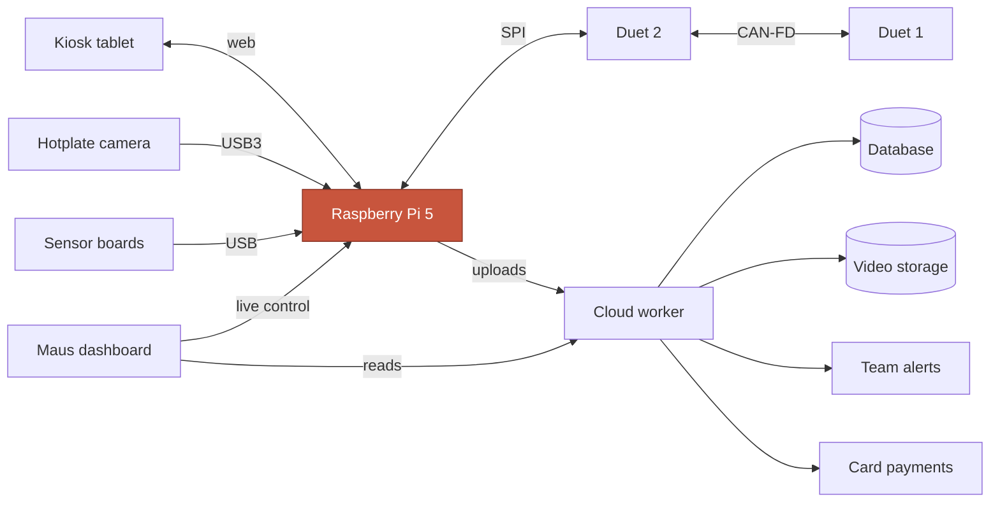
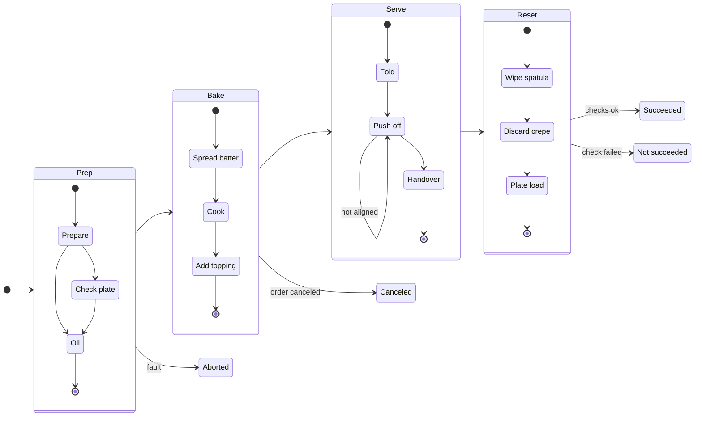
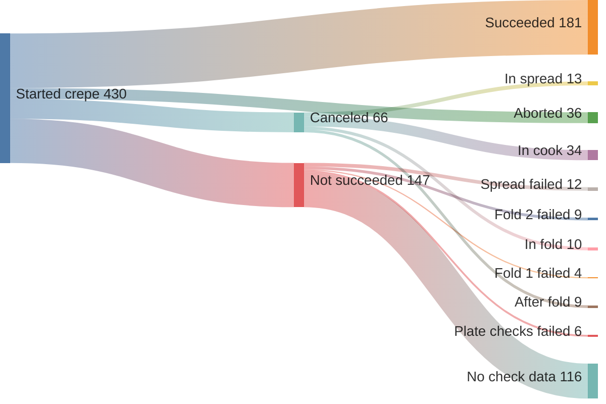
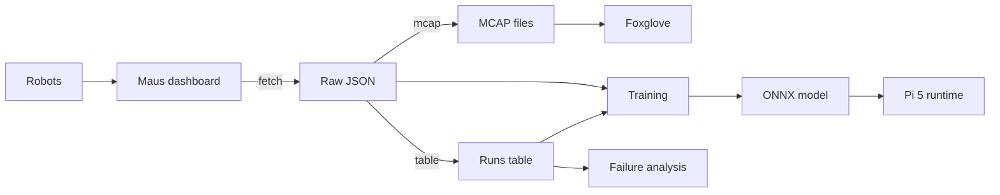
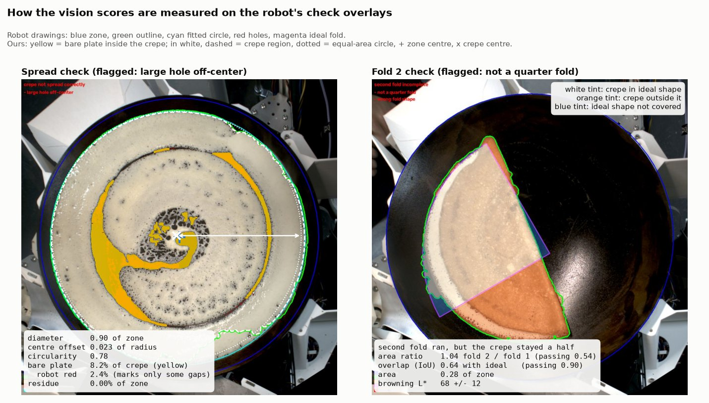
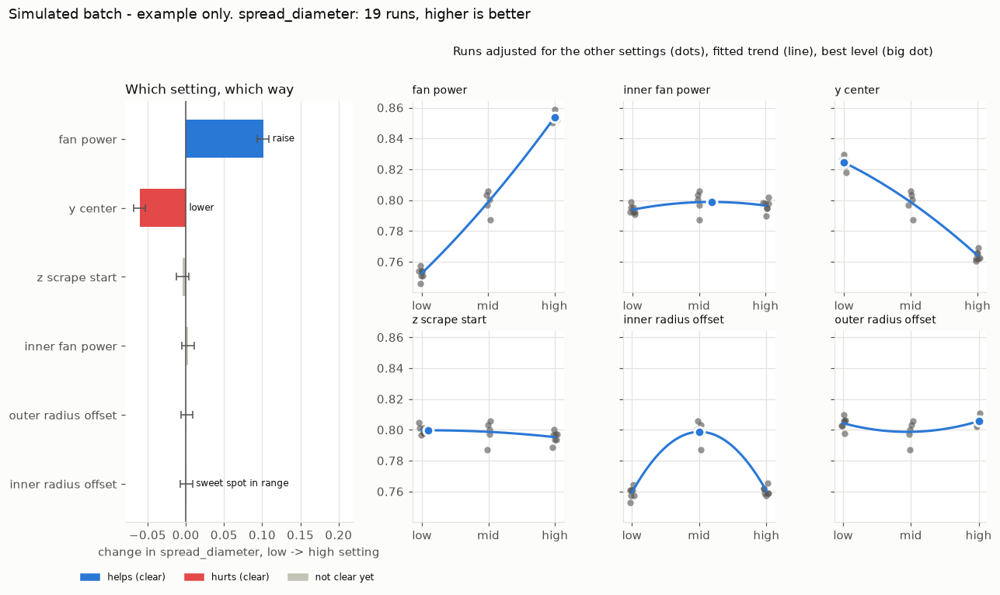

# Maus Crêpe Insights - BaselHack 2026

Our BaselHack 2026 project on the **Maus Robotics** challenge. Maus builds autonomous crêpe robots.
Every run is logged with phases, machine logs, on-robot vision checks (with images), recipe parameters and video.
We turn that data into insight: why runs fail, which settings and conditions matter, and how to catch problems early.

**What is in the repository today.** 828 runs exported from the
dashboard as raw JSON and as one ROS 2 MCAP per run, a 177-column runs
table covering every run and its outcome, a per-check verdict model and
a fold-state model shipped as ONNX with model cards, and a private
labeling setup with phase, mask and pixel-prefill workflows. The exact
state, including what does not work yet, is in
[documentation/status.md](documentation/status.md).

**Check it yourself in a minute.**

```bash
cd code && pixi install && pixi run test && pixi run lint
```

The suite runs offline, with no dashboard access and no private data.
Every number in this repository names the command or file that produced
it.

**Where to look next.**

- Data and pipeline: [pipeline](documentation/data/pipeline.md)
- Models and their holdout numbers:
  [code/models](code/models/README.md)
- Why runs fail: [crêpe stages](documentation/system/crepe-stages.md)
- Labeling:
  [private phase pilot](documentation/phase-labeling-pilot.md) and
  [material and hole masks](documentation/mask-labeling.md)
- Fine-tuning against predictions: [project status](documentation/status.md)

## How it works

**The robot.** A Raspberry Pi 5 runs ROS 2 and makes every decision; two Duet boards drive the motion and a
camera above the hotplate feeds the vision checks. More in the
[robot system guide](documentation/system/system.md).

<!-- diagram: system -->

<!-- /diagram -->

**A crêpe run.** Four groups of stages, a vision check before each critical move, and four possible endings.
Timings and check fail rates are in the
[stages guide](documentation/system/crepe-stages.md).

<!-- diagram: crepe-stages -->

<!-- /diagram -->

**Where runs end.** The 430 runs that started a crêpe in our data window, and the first failed check behind
each `not_succeeded` run.

<!-- diagram: where-runs-end -->

<!-- /diagram -->

**Our pipeline.** From the Maus dashboard to MCAP, analysis tables and ONNX models.
Details in [documentation/data/pipeline.md](documentation/data/pipeline.md).

<!-- diagram: pipeline -->

<!-- /diagram -->

**What the vision scores measure.** The robot's check overlays already mark the crêpe outline, holes,
residue and the ideal fold shape. `pixi run vision` reads those marks back as numbers per run (diameter,
centre offset, bare plate inside the crêpe, fold overlap, fold-2/fold-1 area ratio, browning), so failures become measurable
instead of only pass/fail. See the
[vision score columns](documentation/data/pipeline.md#vision-score-columns).



## Team
[leonardoAB1](https://github.com/leonardoAB1) · [Qbyte248](https://github.com/Qbyte248) · [AetherDim](https://github.com/AetherDim) · [salarehman](https://github.com/salarehman) · [timonTscheulin](https://github.com/timonTscheulin) · [WhyAge36](https://github.com/WhyAge36)

## Repo layout (BaselHack template)
```
code/            Python tooling (maus_export) + models
  maus_export/   dashboard → raw JSON → ROS 2 MCAP / analysis tables
  models/        trained models, always exported as ONNX
  tests/
documentation/   data description, MCAP format, diagrams
  diagrams/      Mermaid sources shared by the docs and this readme
assets/          slides, videos, images for the pitch
data/            local exports (gitignored, never committed)
```

## Quickstart
Requires [pixi](https://pixi.sh) and a Maus dashboard account.

```bash
cd code
pixi install

# 1. Download runs; the first sign-in opens a browser.
pixi run fetch --limit 10 --media  # add --video only if mp4s are needed

# 2. Convert to ROS 2 MCAP (one file per run in data/mcap/) and open them in Foxglove
pixi run mcap

# 3. Flat table for analysis: data/runs.csv + data/runs.parquet
pixi run table

# 4. Vision scores from the check overlays (needs --media): data/vision.parquet
pixi run vision

# 5. Candidate run-start inputs and terminal status (not part of `all`):
#    data/training/run_start.parquet
pixi run export training

# 6. Run-start candidates and post-run vision targets
pixi run export vision-targets

# Or fetch, mcap, table and vision together:
pixi run export all --media
# The all command excludes both training datasets; run them separately:
pixi run export training
pixi run export vision-targets
```

Set `MAUS_TOKEN=<bearer token>` to skip the browser sign-in.

Removing `--limit` does not remove the fetch date defaults or account
permission restrictions. Cached runs can also extend beyond the latest
fetch. A successful fetch may still have missing media. For the complete
private, account-specific fetch-to-vision-target workflow, see the
[collaborator runbook](documentation/training/vision-targets.md).

Which settings matter: `pixi run -e ml analyze` writes `data/analysis/` and prints a shortlist.
See [documentation/analysis/analysis.md](documentation/analysis/analysis.md).

Designed experiment for Maus: `pixi run doe --robot <robot>` writes a run sheet to `data/doe/`,
`pixi run -e ml doe-analyze <sheet>` reads it back once the runs are done.
See [documentation/analysis/doe.md](documentation/analysis/doe.md).

Seen from above, this is a run-to-run feedback loop: the batch measures how
each recipe setting moves the crêpe quality, read through camera, logs and
sensors.

<!-- diagram: doe-loop -->

<!-- /diagram -->



Tests and lint: `pixi run test`, `pixi run lint`, `pixi run fmt`

**VS Code.** Run `pixi install -e ml` in `code/`, open the repo folder (or a worktree folder) and
install the recommended extensions. The shared `.vscode/settings.json` points Python and notebooks
at `code/.pixi/envs/ml`. On macOS or Linux, select `code/.pixi/envs/ml/bin/python` once
("Python: Select Interpreter"). In a notebook, pick that same environment under "Select Kernel".
JupyterLab works too: `pixi run -e ml notebook`.

## Standards we follow
- **Data → [MCAP](https://mcap.dev) (ROS 2 profile)**, the standard container for multimodal robot logs.
  See [documentation/data/mcap.md](documentation/data/mcap.md).
- **Models → [ONNX](https://onnx.ai)**. Train with any framework, ship `.onnx` and run it with `onnxruntime`.
  See [code/models/README.md](code/models/README.md). Use the pixi `ml` environment: `pixi run -e ml ...`.

## Contributing
Workflow, code style and agent rules: see [AGENTS.md](AGENTS.md).

## Documentation

[Browse all documentation](documentation/README.md) by subject.

- [Project status: what works and what does not](documentation/status.md)

- [What data the dashboard has](documentation/data/data.md)
- [MCAP topics & schemas](documentation/data/mcap.md)
- [Robot system](documentation/system/system.md)
- [Crêpe stages and where runs fail](documentation/system/crepe-stages.md)
- [Which settings matter (history analysis)](documentation/analysis/analysis.md)
- [Designed experiment (DoE batch)](documentation/analysis/doe.md)
- [Data pipeline and data model](documentation/data/pipeline.md)
- [Candidate run-start dataset](documentation/training/training-dataset.md)
- [Data preparation handoff](documentation/training/data-preparation-handoff.md)
- [Vision-target training dataset](documentation/training/vision-targets.md)
- [Frame-level check dataset](documentation/frames.md)
- [Frame embeddings](documentation/frame-embeddings.md)
- [Private phase-labeling pilot](documentation/phase-labeling-pilot.md)
- [Camera rectification](documentation/rectification.md)
- [Per-robot correction](documentation/robot-correction.md)

## License
PolyForm Noncommercial 1.0.0 - see [license.txt](license.txt).

The code, models and documentation here are free for noncommercial use:
research, study, teaching, personal projects and noncommercial
organizations. Commercial use, including shipping any of it inside a
product or a paid service, needs a separate license from the copyright
holders. Open an issue to ask for commercial terms.

Revisions published before this change were released under MIT and keep
their MIT terms for anyone who already has them.
