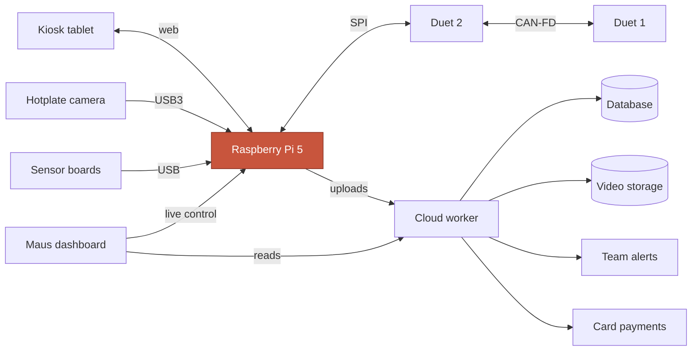
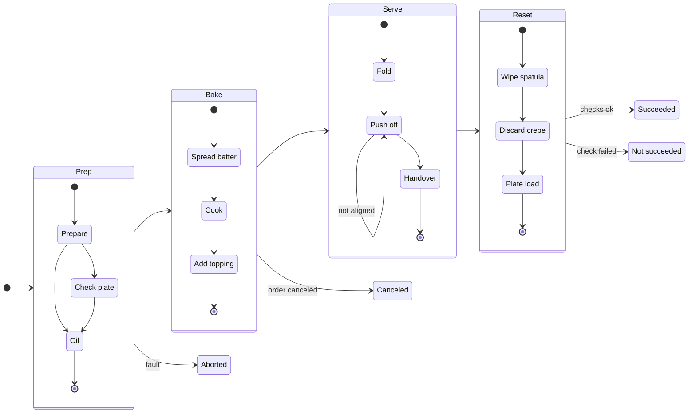
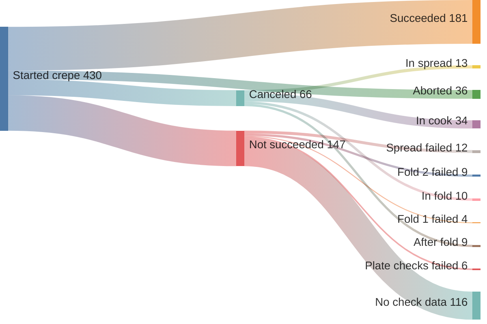
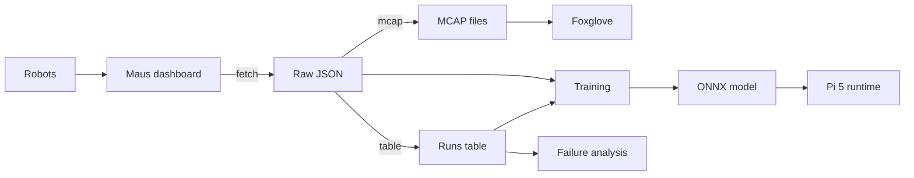
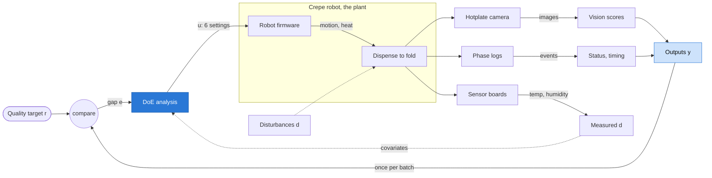

# Maus Crêpe Insights - BaselHack 2026

Our BaselHack 2026 project on the **Maus Robotics** challenge. Maus builds autonomous crêpe robots.
Every run is logged with phases, machine logs, on-robot vision checks (with images), recipe parameters and video.
We turn that data into insight: why runs fail, which settings and conditions matter, and how to catch problems early.

## How it works

**The robot.** A Raspberry Pi 5 runs ROS 2 and makes every decision; two Duet boards drive the motion and a
camera above the hotplate feeds the vision checks. More in [documentation/system.md](documentation/system.md).

<!-- diagram: system -->

<!-- /diagram -->

**A crêpe run.** Four groups of stages, a vision check before each critical move, and four possible endings.
Timings and check fail rates in [documentation/crepe-stages.md](documentation/crepe-stages.md).

<!-- diagram: crepe-stages -->

<!-- /diagram -->

**Where runs end.** The 430 runs that started a crêpe in our data window, and the first failed check behind
each `not_succeeded` run.

<!-- diagram: where-runs-end -->

<!-- /diagram -->

**Our pipeline.** From the Maus dashboard to MCAP, analysis tables and ONNX models.
Details in [documentation/pipeline.md](documentation/pipeline.md).

<!-- diagram: pipeline -->

<!-- /diagram -->

**What the vision scores measure.** The robot's check overlays already mark the crêpe outline, holes,
residue and the ideal fold shape. `pixi run vision` reads those marks back as numbers per run (diameter,
centre offset, bare plate inside the crêpe, fold overlap, fold-2/fold-1 area ratio, browning), so failures become measurable
instead of only pass/fail. Columns in [documentation/pipeline.md](documentation/pipeline.md#vision-score-columns).


## Team
[leonardoAB1](https://github.com/leonardoAB1) · [Qbyte248](https://github.com/Qbyte248) · [AetherDim](https://github.com/AetherDim) · [salarehman](https://github.com/salarehman) · [timonTscheulin](https://github.com/timonTscheulin) · [WhyAge36](https://github.com/WhyAge36)

## Repo layout (BaselHack template)
```
code/            Python tooling (maus_export) + models
  maus_export/   dashboard → raw JSON → ROS 2 MCAP / analysis tables
  models/        trained models, always exported as ONNX
  tests/
documentation/   data description, MCAP format, diagrams
  diagrams/      Mermaid sources shared by the docs and this readme
assets/          slides, videos, images for the pitch
data/            local exports (gitignored, never committed)
```

## Quickstart
Requires [pixi](https://pixi.sh) and a Maus dashboard account.

```bash
cd code
pixi install

# 1. Download runs; the first sign-in opens a browser.
pixi run fetch --limit 10 --media  # add --video only if mp4s are needed

# 2. Convert to ROS 2 MCAP (one file per run in data/mcap/) and open them in Foxglove
pixi run mcap

# 3. Flat table for analysis: data/runs.csv + data/runs.parquet
pixi run table

# 4. Vision scores from the check overlays (needs --media): data/vision.parquet
pixi run vision

# 5. Candidate run-start inputs and terminal status (not part of `all`):
#    data/training/run_start.parquet
pixi run export training

# 6. Run-start candidates and post-run vision targets
pixi run export vision-targets

# Or fetch, mcap, table and vision together:
pixi run export all --media
# The all command excludes both training datasets; run them separately:
pixi run export training
pixi run export vision-targets
```

Set `MAUS_TOKEN=<bearer token>` to skip the browser sign-in.

Removing `--limit` does not remove the fetch date defaults or account
permission restrictions. Cached runs can also extend beyond the latest
fetch. A successful fetch may still have missing media. For the complete
private, account-specific fetch-to-vision-target workflow, see the
[collaborator runbook](documentation/vision-targets.md).

Which settings matter: `pixi run -e ml analyze` writes `data/analysis/` and prints a shortlist.
See [documentation/analysis.md](documentation/analysis.md).

Designed experiment for Maus: `pixi run doe --robot <robot>` writes a run sheet to `data/doe/`,
`pixi run -e ml doe-analyze <sheet>` reads it back once the runs are done.
See [documentation/doe.md](documentation/doe.md).

Seen from above, this is a run-to-run feedback loop: the batch measures how
each recipe setting moves the crêpe quality, read through camera, logs and
sensors.

<!-- diagram: doe-control-loop -->

<!-- /diagram -->


Tests and lint: `pixi run test`, `pixi run lint`, `pixi run fmt`

**VS Code.** Run `pixi install -e ml` in `code/`, open the repo folder (or a worktree folder) and
install the recommended extensions. The shared `.vscode/settings.json` points Python and notebooks
at `code/.pixi/envs/ml`. On macOS or Linux, select `code/.pixi/envs/ml/bin/python` once
("Python: Select Interpreter"). In a notebook, pick that same environment under "Select Kernel".
JupyterLab works too: `pixi run -e ml notebook`.

## Standards we follow
- **Data → [MCAP](https://mcap.dev) (ROS 2 profile)**, the standard container for multimodal robot logs.
  See [documentation/mcap.md](documentation/mcap.md).
- **Models → [ONNX](https://onnx.ai)**. Train with any framework, ship `.onnx` and run it with `onnxruntime`.
  See [code/models/README.md](code/models/README.md). Use the pixi `ml` environment: `pixi run -e ml ...`.

## Contributing
Workflow, code style and agent rules: see [AGENTS.md](AGENTS.md).

## Documentation
- [What data the dashboard has](documentation/data.md)
- [MCAP topics & schemas](documentation/mcap.md)
- [Robot system](documentation/system.md)
- [Crêpe stages and where runs fail](documentation/crepe-stages.md)
- [Which settings matter (history analysis)](documentation/analysis.md)
- [Designed experiment (DoE batch)](documentation/doe.md)
- [Data pipeline and data model](documentation/pipeline.md)
- [Candidate run-start training dataset](documentation/training-dataset.md)
- [Vision-target training dataset](documentation/vision-targets.md)

## License
MIT - see [license.txt](license.txt).
